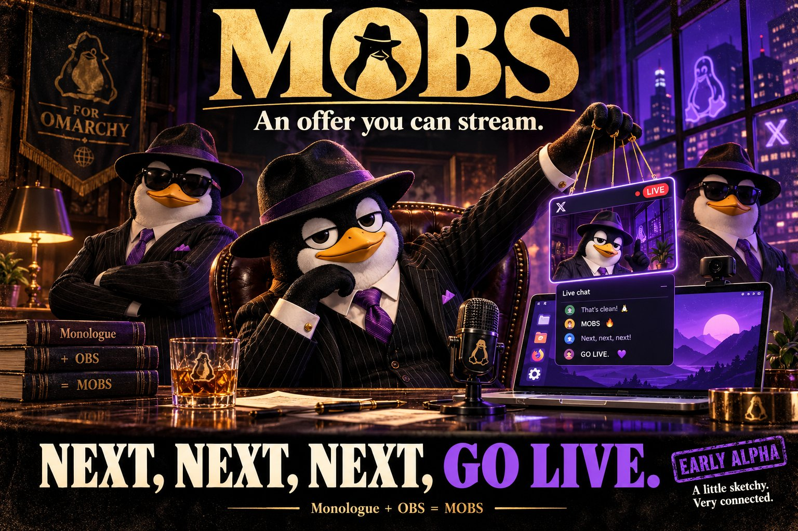
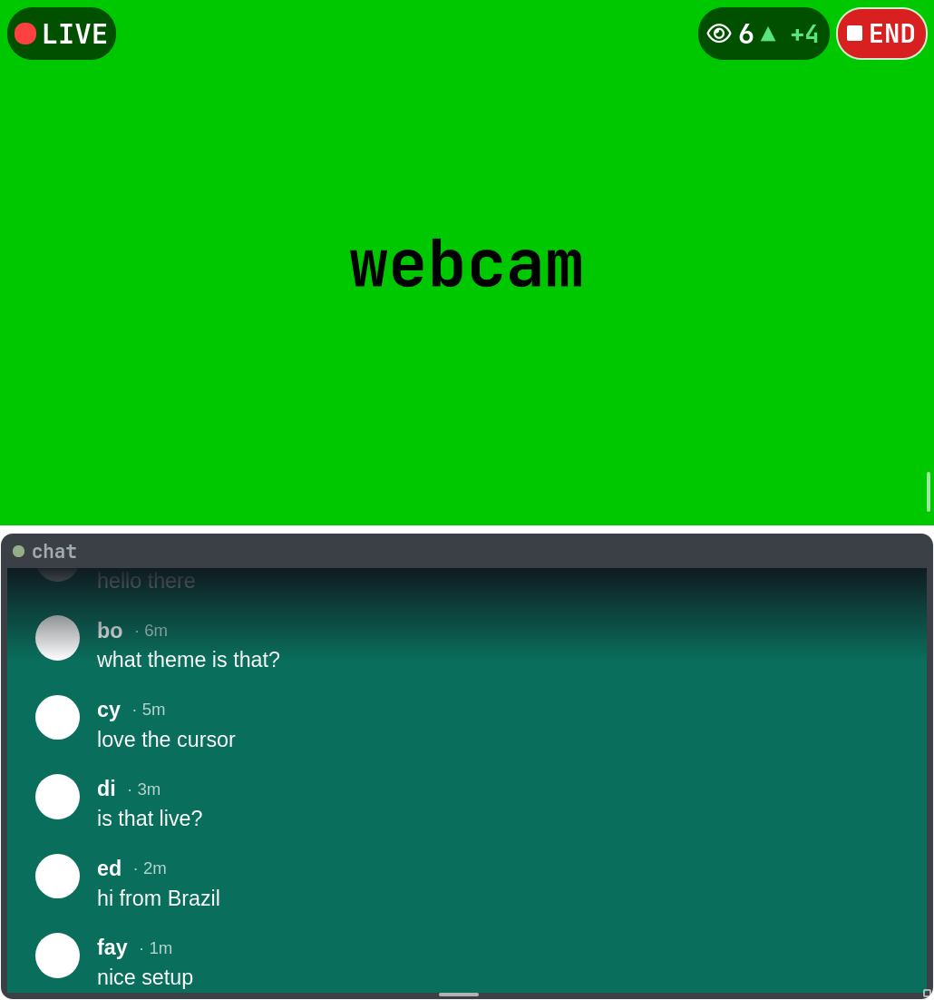

<p align="center">
  
</p>

<h1 align="center">MOBS</h1>

<p align="center">
  <b>Monologue + OBS = MOBS.</b><br>
  One window for <a href="https://omarchy.org">Omarchy</a> that records your screen and webcam and goes live on X.<br>
  A guide clicks <i>next, next, next</i>. Then one red button does the rest.
</p>

<p align="center">
  
  
  
</p>

> **MOBS is early alpha.** It is built on the author's own Omarchy machines and it has gone live on X for real, but it is
> rough in places, and it only runs where Hyprland, PipeWire and the OBS engine are. [`STATUS.md`](STATUS.md) says what is
> proven, what is not, and what is next.

---

## What it is

MOBS is its own application, not a skin over OBS and not a window that drives a hidden OBS. It has the OBS engine
(**libobs**) built in, so it captures your screen, your webcam and your sound and encodes them itself. Recordings open in
**Monologue's** timeline editor (trim, split, cut). The window follows your live Omarchy theme.

It is made for a beginner streamer: pick your camera and microphone once, press **GO LIVE**, and MOBS does the steps in X's
Live Studio for you. It is also made so that you can always stop: there is a red **END** button on the webcam that stops the
video and ends the livestream on X, in one press.

## What you get

- **A guide with a big NEXT button.** Eight pages: welcome, camera, microphone, your screen, your webcam, your X account,
  going live, all set. Each page shows what to do, and NEXT stays grey until the page's job is done. It opens by itself the
  first time and again whenever something is missing.
- **Camera and microphone that stay picked.** Choose them once and lock them in. A locked camera that is unplugged is
  reported as unplugged; it is never swapped for another one behind your back. The microphone list shows every input, and says
  which one the system default is.
- **Your whole screen, every workspace.** MOBS never asks for a window or a region: it shares the whole monitor, so the
  stream follows you when you change workspaces.
- **One GO LIVE button.** Type a title (it is remembered), press the button, and MOBS opens X's Live Studio in its own browser,
  types the title, checks who can watch, waits until X says it sees your video (X looks every 20 seconds, so this can take up
  to a minute), presses **Go Live**, attaches your chat and steps its own window out of the picture. If X changes something,
  MOBS says what X said and hands the box to you.
- **Nothing to copy by hand.** Sign in to X once, in MOBS's own browser. MOBS finds your source on X (or makes one), reads the
  stream key and the server address from X itself, and keeps the key in a private file.
- **Your webcam as a window on the screen.** Floating, pinned to every workspace, draggable with `SUPER + drag`, resizable.
  Because the whole screen is the picture, this is what puts you in it.
- **Your X chat under the webcam.** The messages of your livestream, in the same window, so when you move the webcam the chat
  moves with it. Read-only: you answer out loud.
- **How many are watching, and which way it is going.** Beside the webcam: an eye, the number, and a green **▲ +3** or red
  **▼ -2** against about two minutes ago.
- **A kill switch.** The red **END** button stops the video this instant and ends the livestream on X, so nobody is left
  watching a dead stream. Every other way of stopping a broadcast (the stop button, Enter, closing the window, the hotkey)
  does the same.
- **Text that grows with the window.** The whole interface is drawn on a canvas that is scaled up to fill the window: on a
  big or tiled window the text is big, and nothing scrolls or gets cut off.
- **A recording that is always saved.** A broadcast is a second encode of the same picture; the full-quality 1080p MP4 is
  written next to it whatever happens to the stream.
- **A hotkey that works from any app.** `SUPER + SHIFT + V` starts and stops (and ends a livestream), over D-Bus.
- **Careful with secrets.** The stream key lives in a file only you can read, never in a log, never on screen. MOBS never sees
  your X password (you type it into X's own page).

## Screenshots

These are rendered with stand-in devices and a stand-in Live Studio page, so they show no real account or camera.

| | |
|:--|:--|
|  |  |
| **Camera.** A live picture of you, then *this is my camera*. | **Microphone.** Say something, watch the bar, lock it in. |
|  |  |
| **Your X account.** Sign in once; the key and address come from X. | **Going live.** What MOBS does for you in Live Studio. |
|  |  |
| **Ready.** A title, who can watch, one big button. | **Going live.** MOBS types the title and waits for X. |

**The webcam window while you are live:** your camera, the LIVE badge, how many are watching with its trend, the END button,
and the chat under you.



## How a stream goes

1. **First run.** The guide walks you through camera, microphone, screen, webcam and X. It takes a few minutes and you only
   do it once.
2. **Every time after.** Open MOBS, check the title, press **GO LIVE to X**. The window shows what MOBS is doing in Live
   Studio, then steps out of the picture. Your webcam window and chat stay on the screen.
3. **While live.** Watch the number and the arrow beside the webcam. The chat scrolls under you.
4. **To stop.** Press **END** on the webcam, or `SUPER + SHIFT + V`. The video stops, the livestream ends on X, and your
   window comes back with the saved recording.

If you only want a recording, **just record, nothing goes to X** is on the ready screen. Anything advanced (encoding, audio,
keys, hardware, the live page) is behind **EXPERT** (`P`).

## Requirements

MOBS targets **Omarchy** (Arch Linux with Hyprland on Wayland). It was written and tested on Omarchy 4.0 with:

| Needs | For |
|:--|:--|
| Qt 6.11 (`qt6-base`, `qt6-declarative`, `qt6-multimedia`, `qt6-webengine`) | the interface, the webcam preview, MOBS's own browser for X |
| OBS Studio 32 (`obs-studio`, which provides **libobs** and its plugins) | capture, encoding, the recording and the stream |
| PipeWire, `pipewire-pulse`, `libpulse` (`pactl`), `xdg-desktop-portal-hyprland` | screen capture (the portal picker opens once), audio and the list of microphones |
| Hyprland (`hyprctl`) | floating and pinning the webcam window, stepping MOBS's own window out of the picture |
| `ffmpeg` | saving edited recordings |
| a webcam, a microphone | the usual |
| an X account that can use **Live Studio** (it needs X Premium; check X's current rules) | going live |
| `cmake`, `ninja`, a C++20 compiler, `python3` | building and testing |

Hardware encoding was verified with an NVIDIA card (NVENC); software x264 is the fallback and works everywhere.

## Build and install

```sh
git clone https://github.com/nixfred/mobs.git
cd mobs/mobs/app
cmake -S . -B build -G Ninja
cmake --build build
cmake --install build --prefix ~/.local      # binary, launcher entry, icon, D-Bus launch file
```

MOBS then shows up in your launcher as **MOBS**. Re-run the install after rebuilding.

**The hotkey.** MOBS answers on the session bus as `org.mobs.Control` (`Toggle`, `Pause`, `Kill`, `Status`). Bind keys to
these in your Hyprland config, for example:

```ini
bind = SUPER SHIFT, V,      exec, busctl --user call org.mobs.Control /org/mobs/Control org.mobs.Control Toggle
bind = SUPER CTRL SHIFT, V, exec, busctl --user call org.mobs.Control /org/mobs/Control org.mobs.Control Pause
```

If MOBS is not running, D-Bus starts it. `Toggle` starts a recording, or stops a take and (if it was a broadcast) ends the
livestream on X. `Kill` does the same as the END button. Only one copy of MOBS runs at a time: a second launch says so and
leaves the first one alone, so two copies never fight over one webcam or one stream key.

**Where things live**

| What | Where |
|:--|:--|
| Recordings | `~/Videos/mobs` (the folder can be changed in EXPERT) |
| Settings | `~/.config/mobs/mobs.conf` |
| Stream key | `~/.config/mobs/stream-key`, readable only by you |
| MOBS's browser profile (your X sign-in) | `~/.config/mobs/web`, treat it like a password |
| Log | `~/.local/state/mobs/mobs.log`, always written, the key is never in it |

## Keys

| Key | Does |
|:--|:--|
| `Space` | record (ready screen), pause and resume (while recording; not while live) |
| `Enter` | stop and save (ends the livestream if you were live) |
| `P` | EXPERT |
| `Esc` | back out of EXPERT or a guide page |
| `SUPER + SHIFT + V` | the hotkey: start, or stop and end |
| `SUPER + drag` / `SUPER + right-drag` | move / resize the webcam window |

## How it works

```
 Qt Quick interface (QML)            the guide, the ready screen, the go-live window, EXPERT, the editor
        |
   Engine (state machine)            idle > starting > recording > stopping, the stream's own states
        |
   ObsBackend (libobs, in process)   scene: screen (PipeWire portal) + camera (v4l2) + audio (PulseAudio)
        |                            outputs: the MP4 file, and an RTMP stream with its own encoders
        |
   PipController (Hyprland)          the webcam window: floated, pinned, placed; MOBS's window steps aside while live
        |
   MOBS's own browser (QtWebEngine)  a private profile, only ever on x.com
        |-- SourcePilot              finds your source, reads the stream key and server address from X
        |-- LivePilot                types the title, waits for "source on", presses Go Live, reads the livestream's address
        |-- chat view (in the dock)  shows the messages, reads how many are watching, presses End livestream
```

- The helpers read and press X's page **by its words and labels** ("New Livestream", "Go Live", "End livestream"), never by its
  generated class names, and they were written against the real page. They match X's English. If X changes a label, MOBS
  says what it saw and the box becomes yours.
- MOBS does not load OBS's `rtmp-services` module, because that module asks obsproject.com for a service list. MOBS registers
  its own tiny RTMP target instead and never phones home.
- A broadcast is a second pair of constant-bitrate encoders into libobs's RTMP output; the saved file is always the full 1080p
  copy. The stream defaults to what X's own encoder panel recommends (H.264, 1920x1080, 30 fps, 9 Mbps, AAC 128 kbps).
- The whole interface is laid out on a canvas of at least 860 by 560 and scaled to the window, which is why it never scrolls and
  the text is big on a big screen.

## If something goes wrong

MOBS says what is wrong on screen first. The log has the rest: `~/.local/state/mobs/mobs.log` (it never holds your stream key).

- **Go Live stays grey in Live Studio.** X keeps it grey until the livestream has a title and X sees your video. MOBS types the
  title and waits for X on its own; the window shows X's own sentence while it waits. If it gives up, the box is yours.
- **The picture is black.** Press the screen button and choose again; MOBS says so loudly when the shared screen delivers nothing.
- **The chat does not show.** It needs the X sign-in from the guide (page 6). The webcam window says "waiting for the first
  message..." until somebody writes. Lines starting `[chat]` and `[pilot]` in the log say what MOBS saw on X's page.
- **MOBS says another copy is running.** One copy at a time owns the webcam and the stream key. Look for its window, or stop it
  with `busctl --user call org.mobs.Control /org/mobs/Control org.mobs.Control Kill`.
- **Stopping did not end the livestream on X.** It does when MOBS can reach the livestream's page; if it could not, the notice
  says so and opens Live Studio, where **End livestream** is one button.

## Testing

```sh
cd mobs/app
cmake -S . -B build -G Ninja && cmake --build build
ctest --test-dir build --output-on-failure        # 16 unit suites, an install check, and the scripted UI scenarios
python3 tests/check_ui.py build/mobs              # the 330+ scripted UI scenarios on their own
```

The scripted scenarios run the real QML offscreen with a fake backend, fake cameras and a stand-in Live Studio page, in an
isolated environment: a test never opens a real camera, key, browser profile or log, and never touches the desktop clipboard.
They check the layout of every screen at several window sizes (and that no text is smaller than a set size once scaled), the
whole guide, the go-live helper, the kill switch, the viewer trend and the chat card. A separate test drives the real libobs in a
Wayland session. [`mobs/app/README.md`](mobs/app/README.md) lists every switch and script step.

## Repository layout

| Path | What |
|:--|:--|
| [`mobs/app/`](mobs/app) | the MOBS application: `src/` (C++), `qml/` (screens), `assets/`, `dist/` (launcher, icon, D-Bus file), `tests/` |
| `obs/` | OBS Studio, imported with its full history as a git subtree (GPLv2), not modified |
| `monologue/` | Monologue, imported with its full history as a git subtree (MIT), not modified; its timeline editor is used by path |
| [`docs/`](docs) | architecture decisions (`docs/adr/`), the tech and screen designs, screenshots |
| [`STATUS.md`](STATUS.md) | the running log: what was built, what was verified, what was not |

OBS and Monologue are kept as subtrees with their original commit hashes, so updates from their official repositories can
still be pulled in. MOBS's own code lives outside both.

## Status

**Works, and has been used for real:** the guide; locked camera and microphone; whole-screen capture; a 35 minute livestream on
X at about 9 Mbps with no dropped frames; the helper pressing Go Live; the chat under the webcam; the viewer count; recording
with pause; the editor; the hotkey.

**Not done, or not proven:**

- It is Omarchy and Hyprland only. Windows and macOS are not planned.
- Going live needs an X account with access to Live Studio, and the helpers speak X's English.
- The kill switch's End press and the viewer reading are checked against X's real page in pieces, and by scripted tests against a
  stand-in page; the first full real runs are still coming in.
- Guests: X has no way to bring a watching viewer onto a stream, so there is no guest call.
- Voice dictation and transcripts are left to Omarchy's own tools.

## Docs

- [`STATUS.md`](STATUS.md): the log of what was built and verified
- [`mobs/app/README.md`](mobs/app/README.md): the developer reference (every screen, switch, script step and gotcha)
- [`docs/tech-design.md`](docs/tech-design.md) and [`docs/screen-design.md`](docs/screen-design.md): the designs
- [`docs/adr/`](docs/adr): why MOBS is one app on libobs, why one repo with two upstreams, and the other decisions

## Contributing

MOBS is built for the author's own machines, so there are no support promises, but bug reports and patches are welcome. Run the
tests before you send one (see above). Please leave `obs/` and `monologue/` alone: fixes for those belong to their own
projects, and the subtrees are kept as they are so upstream updates still merge.

## License and credits

MOBS is **GPLv2** (see [`LICENSE`](LICENSE) and [`NOTICE`](NOTICE)). It links libobs, which is GPLv2, and reuses Monologue, which
is MIT.

- **OBS Studio**: the engine MOBS is built on. https://github.com/obsproject/obs-studio
- **Monologue**: the timeline editor and the Omarchy theme reader. https://github.com/omacom/monologue
- **Omarchy**: the system MOBS is made for. https://omarchy.org
- **Qt**: the interface and the browser.

*An offer you can stream.*
