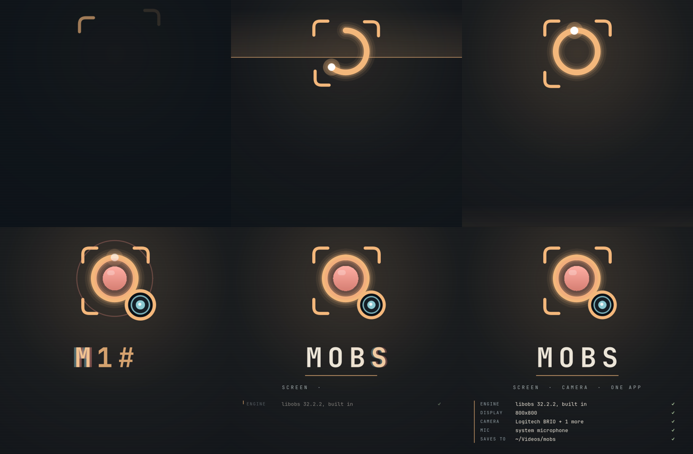
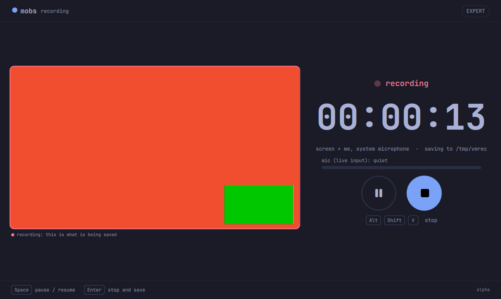
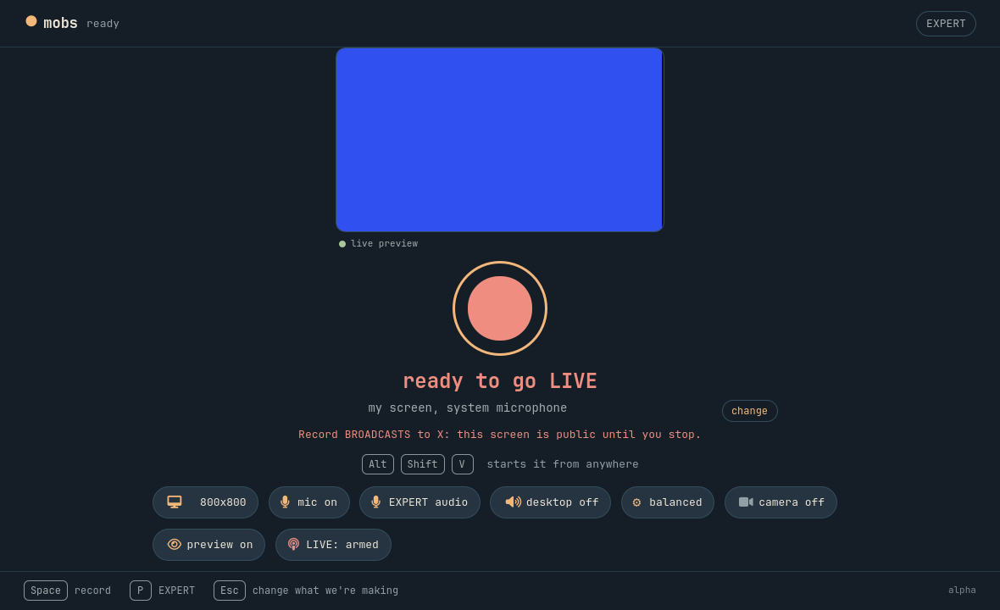
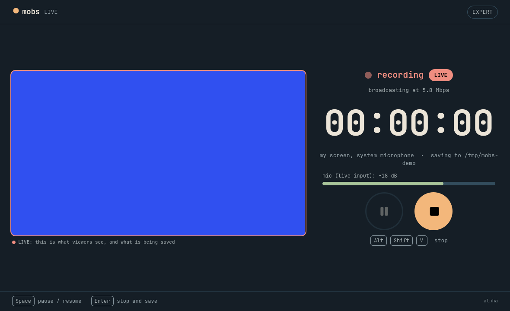

# mobs: status

- Started: 2026-10-09, from an idea-box entry
- Stage: product architecture decided 2026-10-09 (ADR 0006); app skeleton (mobs/app) built; spike 4 proved libobs in-process recording.
- Repo: github.com/nixfred/mobs. OBS and Monologue are git subtrees (obs/, monologue/) with full history and the official upstreams as remotes (ADR 0002).
- Finding: Monologue is a webcam recorder with a trim editor (Qt 6 QML, C++), not a voice tool. Voxtype (already on Omarchy) is the dictation tool.

## Decided (Fred, 2026-10-09; details in README.md)

- For: Fred only, on his Omarchy machines (gus, vic).
- Destination: all of OBS's and Monologue's features in one app. Left out: Windows and macOS, voice dictation and transcripts. Live streaming: built 2026-10-10 (to X or any RTMP server, see "Going live to X" below). Not ruled out: packaging.
- Hotkey: physical Alt + Shift + V starts/stops (pause: Ctrl + Alt + Shift + V). Alt + Shift + R was taken (Rename workspace).
- Interface: "super easy for beginners, satisfy experts, not too much like OBS, Omarchy feel." MOBS is its own application in the live Omarchy theme. **Fred, later the same day: "I don't want an overlay. I want a new product."** So MOBS is one program with libobs (the OBS engine) embedded in-process, no OBS app, no websocket, nothing hidden (ADR 0006, replaces ADR 0005 and 0003). Beginner: three cards then one Record button. Expert: a Pro drawer that grows to cover what OBS can do.

## Evidence

- Spike 1 and 2 (ADR 0004, mobs/spike/): Monologue's real EditBar.qml runs in an OBS dock on native Wayland with Qt Quick software rendering (OpenGL turned OBS's preview black, A/B in the VM); real video plays via QVideoSink to QImage, also on gus's real hardware. But OBS exits cleanly only about half the time with any QML dock loaded on gus (no plugin 6/6, plugin without dock 6/6, empty QML dock 4/8 stuck, full dock 3/6; one cause found, the "Closing Dockable Window" dialog, the rest unexplained). That is why MOBS left OBS's window.
- Screen prototype (mobs/design/, docs/design/screen-1..5.png, docs/screen-design.md): five screens in the live Liftoff theme, rendered in the Test Drive VM with sample data only. Screen 4 uses Monologue's EditBar.qml unmodified.
- Practice copy: Test Drive VM test-drive-mobs-spike (OBS 32.2.2, Qt 6.11.2, cmake/ninja; its package DB was stale, refreshed with pacman -Sy). Still running.

- Spike 3 (mobs/spike3/, ADR 0005): PASSED for the control plane in the VM. OBS hidden on special:mobs, websocket auth, scene/input, record, pause (cut 2 s of a 7 s run), resume, stop, file path back, OBS alive throughout. Learned: RecQuality must not be Stream or pause does nothing; wait for the RecordStateChanged STOPPED event, the file is not final when StopRecord replies.

## Spike 4 (mobs/spike4, ADR 0006): PASSED in the VM

A Qt program with libobs embedded recorded a valid file with pause, on native Wayland, no OBS application running: 12 of 13 engine plugins (NVENC absent in the VM), x264 + AAC, mp4_output, 4.8 s from 3 s + 2 s paused + 2 s, 16 of 16 clean exits after three fixes: set the Wayland platform before obs_startup, load engine plugins by name (never obs_load_all_modules), and obs_wait_for_destroy_queue before obs_shutdown. Spike 3 (hidden OBS over websocket) is superseded; its portal findings stand.

Spike 4b, real gus hardware: in-process PipeWire screen capture works. First run opened the picker (Fred picked), recording with pause had real content (1,871 colours); MOBS saved the restore token itself and the second run needed no picker (2,279 colours). Watch: "Cannot create EGLImage" warnings (fallback worked).

## Engine and real recording (mobs/app, 2026-10-09): works in the VM

`Engine` (state machine) + `RecorderBackend` interface + `ObsBackend` (libobs in-process, RAII-ordered teardown, non-blocking start while the picker is open, restore token saved the moment the portal answers). 15 engine tests with a fake backend (a deliberate bug in the pause logic was first NOT caught, so I strengthened the test and re-proved it fails), 3 real-libobs integration tests on Wayland (record + pause with a duration check, record twice in one process, cancel before start). Driven like a user in the VM with real key presses (choose, Space, Space, Space, Enter): a 1920x1080 H.264 + AAC file of 6.40 s from 6.81 s key-timed recording with a 2.24 s pause cut out. Run on gus's real screen through the app on 2026-10-10 (see below).

## Review screen (2026-10-10): built, tested, and run through the whole loop in the VM

After a recording is saved the app opens it for review: playback that skips cut gaps, Monologue's UNMODIFIED EditBar.qml (mapped into the module from the subtree; type name and qml/ directory needed explicit CMake properties), a `Review` object that mirrors Monologue's editing rules (a drag is ONE undo step; clips grow into gaps never over neighbours; the last clip can't be removed; atomic export to a hidden partial file), save writes `<name> (edited).mp4` beside the original, delete goes to the TRASH, leaving asks first. The engine writes `<take>.mobs.json` with the pause points so the timeline shows where you paused. 19 review tests with real ffmpeg (export keeps ~4 s of 6 with audio, original byte-for-byte unchanged, no partial files left, a vanished source fails cleanly and stays unsaved, delete lands in a temp trash), engine sidecar tests, app-state tests. VM run through the app's own script: record 2 s + pause 1 s + 3 s, review opened by itself, split at 1.5 and 3.5 s, cut the middle, saved: take 5.0 s, sidecar pause at 2.085 s, edited 2.97 s, original still 5.0 s. Also fixed: MOBS now logs only warnings and errors from libobs (a running MOBS was writing ~60 debug lines per second to the user journal); install test now also catches a binary that cannot find its own QML types.

## Live preview (2026-10-10): built and tested in the VM

The `preview` chip on the ready screen shows what will be recorded. ObsBackend now has two lifetimes: the GRAPH (scene + screen/camera sources, lives while previewing or recording) and the RECORDING (mic, encoders, file, only while recording), so a recording reuses the preview's scene and a second screen-share dialog never opens. Frames: `obs_add_raw_video_callback2` (BGRA, 640x360, divisor 2 = 15 fps) copied on libobs's video thread, newest only, handed to the Qt thread, served to QML through an image provider. 14 real-libobs tests in the VM (all pass), new ones read the pixels of preview frames: frames arrive repeatedly; the webcam sits in the chosen corner; tapping another corner/size moves it in the SAME scene; switching the preview off really stops frames; a recording while previewing produces a file with the same picture, the preview keeps running during and after; two recordings in a row clean up. A deliberate bug (placement not updated) was caught by the placement test on the exact assertion. Unit: 8 suites pass on gus (engine preview rules incl. camera unplugged, saved setting default off, model thread-safety). NOT yet run with the real screen picker or the real webcam preview on gus; ask Fred first (turns the camera on).

## Launcher, icon and hotkey bind installed on gus (2026-10-10)

`cmake --install build --prefix ~/.local` puts MOBS in the launcher with a new icon (mobs/app/dist/mobs.svg), and installs the D-Bus launch file. Verified: desktop file valid; GIO sees it (name MOBS, Exec correct); the icon resolves by name at 32/48/128 px under the Yaru-blue theme; launching through the entry (gtk-launch) opened a window of class `mobs`; with MOBS closed the hotkey's busctl call started it in 0.6 s. Bugs found on the way, each now guarded by a test: the installed Exec/TryExec had the default prefix (/usr/local/bin) because CMake filled it at configure time, so the launcher would have hidden MOBS (now filled at install time); the INSTALLED binary exited with "Module Mobs contains no type named Main" because the QML module's qmldir said `prefer :/Mobs/` and only worked next to the build folder (fixed with qt_policy QTP0001 NEW and a separate module name for the C++ types; ctest now installs to a temp prefix and RUNS that binary). Hyprland binds added to ~/.config/hypr/bindings.lua as a marked BEGIN/END block (backup bindings.lua.bak-mobs-hotkey-20261010): SUPER+SHIFT+V toggle, SUPER+CTRL+SHIFT+V pause (physical Alt+Shift+V); verified registered, no config errors, clipboard-policy check all OK. Side effect to know: the reload dropped the live bind count 303 -> 291 (runtime binds that a config reload clears; with my block it is 293; the 12 are unidentified because I did not snapshot first). Also added: a visible "change" pill on the ready screen (the three choices were only reachable by Esc or the camera chip).

## Real webcam run on gus (2026-10-10 00:2x)

Logitech BRIO through MOBS (script mode, no keys): negotiated MJPEG 1280x720 at 30 fps. Screen + me (bottom-right, medium): 5.30 s, 1920x1080 H.264 + AAC, camera box has a real picture (813 colours) and the rest is real screen content (1637 colours; Fred picked a screen/window, not a region). Camera only: recorded fine, but the picture covered only ~12% of the frame. Cause found by comparing with a native ffmpeg grab of the same camera (46-59% non-black, full width): libobs treated the webcam's FULL-range MJPEG as limited range and crushed dark pixels in a dim room. Fix: color_range = FULL for the v4l2 source; after it MOBS shows 52% non-black spanning the full width vs 59% native. (An async stand-in source filling the frame was checked first to rule out geometry.) Frames judged by numbers only, never viewed; files deleted.

## Cameras (2026-10-10): built and tested in the VM, then run on the real BRIO (above)

Answer to Fred's question "where is the input for my camera and how do I place it": the camera chip on the ready screen opens a panel (which webcam; screen + me corner and size with a tap-a-corner diagram; just my camera fills the frame). gus has two cameras found under /dev/v4l/by-id: Logitech BRIO and HD Webcam. Engine refuses a camera pick with no camera and opens the panel. ObsBackend builds screen / screen + camera / camera-only scenes with libobs's v4l2_input (1280x720 MJPEG when supported) and reports a camera that never starts as a camera problem. 22 engine, 15 app-state, 10 camera/placement tests, plus 9 real-libobs tests in the VM that read the pixels of saved files: the stand-in camera lands in each corner, the opposite corner and the middle stay screen, sizes grow, camera-only fills the frame. Two bugs found by tests/looking and fixed: the serial-number stripper removed the word Webcam from a camera name; the panel diagram did not follow corner/size changes (QML dependency). NOT yet run with a real webcam on gus (turns the camera on and records a face: needs Fred's OK).

## Hotkey (2026-10-10): works over real D-Bus in the VM

`org.mobs.Control` (Toggle, Pause, Status) in the app, 6 unit tests, and a real `busctl` run: Toggle, Pause, Pause, Toggle produced a valid file with the pause cut out; D-Bus auto-launch (after a bus config reload) started MOBS in 0.5 s and the next Toggle recorded; a second copy does not steal the name. NOT yet bound on gus: bindings.lua is Fred's locked live config, so the Hyprland bind waits for his OK (SUPER+SHIFT+V and SUPER+CTRL+SHIFT+V, both free).

## Real run on gus + black-recording warning (2026-10-10)

The app ran on gus with real PipeWire capture via its own test script (no synthetic keys): clean exits, silent second run with the saved token, pause cut 2 s out of a 7 s run. Fred picked a REGION and the video was black, the third run where a region pick did that, so MOBS now checks each saved file and warns in red ("pick a screen or a window"); the picker prompt says the same. 19 engine tests (real ffmpeg black/normal videos); a signed-byte bug in the first version was caught by a test. The leftover "full obs" door was removed (there is no OBS app any more). Still to see: a real run with a screen or window pick through the app (expect real frames).

## App skeleton (mobs/app, 2026-10-09)

- Choose and ready screens in Qt Quick, split into components from the prototype; the live Omarchy palette (full colors.toml + Hyprland rounding via Monologue's theme.cpp, reused by path), remembered pick, real display name. 18 unit tests pass (palette parsing, live theme switch, theme folder replaced, contrast guard, app state).
- Proven in the VM: one running process changed from tokyo-night to Catppuccin Latte when the real Omarchy theme was switched (docs/app/live-*.png). Found and fixed a real problem: Tokyo Night's own dim text colours measure 1.6 to 2.4:1; the palette now lifts dim text to 4.5:1 (rendered card text measured 4.65:1).
- Not wired, and labelled on screen: recording, hotkey, mic/camera, Pro drawer, full OBS, the OBS link.

## Open

- Wayland screen capture is PROVEN end to end on gus (ADR 0005, spike 3b): pre-seeded screen source, hidden OBS, one picker click, real frames, then a silent rerun with the saved restore token. Two cautions: a screen source created live over websocket never opens the picker (load it from a scene collection file instead), and a REGION selection recorded black frames (two runs) while another selection worked. Next to test: loading the collection with SetCurrentSceneCollection.
- New dependency: qt6-websockets (not on gus yet).
- Not built: the Hyprland bind itself on gus (needs Fred's OK),   the Pro drawer and its tabs,  the recording pill, the first-run permission screen, a real run on gus with a screen/window pick.
- Throwaway test configs for gus runs live in the Claude scratchpad, not in ~/.config/obs-studio (Fred's own OBS setup was never touched).

## Pro drawer (2026-10-10): built, tested, pushed

The header "pro" chip (and the P key on screens 1, 2 and 4; Esc closes) opens a right-hand drawer with four tabs: **recording** (quality small / balanced / high = x264 CRF 28 / 23 / 18, save folder with live validation, open folder, reset, open the editor after recording, live preview), **audio** (microphone on or off), **keys** (the hotkey list) and **about**. Settings persist in MOBS's own settings file and apply to the next recording. An unusable folder stops the recording with "cannot save to ... choose another folder in pro > recording" instead of failing silently. 10 of 10 unit suites pass on gus; the 15 real-libobs tests pass in the VM, including one that checks a higher quality makes a bigger file of the same picture. Render: `docs/app/pro-drawer.png` (offscreen, colour test source, isolated settings; no real screen or camera). NOT yet installed to ~/.local: Fred's own MOBS was still recording from the installed binary, so install waits for it to go idle.

Still to do in Pro: frame rate and resolution (needs obs_reset_video while idle), mic level meter and desktop audio, encoder choice (NVENC), per-source volume.

## Reliability and EXPERT follow-up (2026-10-10)

The beginner flow remains three modes then Record, with a one-click mic toggle and quality status. **EXPERT** replaces the Pro label and cramped side drawer with five focused pages. Custom x264 CRF and CPU presets are implemented, remembered, and applied to the next take; the panel retains pause/stop controls during recording. Folder changes are explicit and keyboard focus returns on close.

Repaired: recording filename collisions, unsaved edits discarded by a hotkey, interrupted recording/export on window close, export destinations overwritten by a race, libobs output failures leaving the UI recording, inaccurate mic/folder labels, preview failures affecting recording state, and lost elapsed time on unexpected termination. The development script's asynchronous callback lifetime is also corrected. Both upstream subtrees remain untouched. Source and build changes are local; the installed MOBS and Hyprland configuration are unchanged.

Current delivery details, validation boundaries and the planned beginner/EXPERT controls are in [docs/quality-and-expert.md](docs/quality-and-expert.md). Earlier status paragraphs describe historical milestones; this section and that report describe the follow-up.

Validation: final build and all 11 CTest suites passed, including 29 real-QML scenarios at three window sizes. Separate Wayland libobs integration: 17 Qt checks passed, zero skipped, with generated sources and microphone disabled. Small-window screenshots are [ready](docs/app/ready-simple.png) and [EXPERT encoding](docs/app/expert-encoding.png). Real-device acceptance and installation are not part of this pass.

## Audio, NVIDIA encoding and continued bug hunt (2026-10-10)

The next pass adds named microphone/output selection, an explicit mic check, recording meters, independent gains behind **EXPERT gain**, and opt-in NVIDIA H.264 encoding. EXPERT now has six readable pages. Software remains the default; desktop audio defaults off. Audio lookup has a timeout and explains unavailable inputs. The system NVIDIA helper is copied/installed beside the app when available.

Continued bug hunting repaired a filename race while capture starts, false unsaved state after splitting unchanged content, duplicate exports of saved edits, stale undo availability after trimming, non-finite edits dropping clips, missing host callbacks in the timeline, interrupted trims retaining gesture state, and obsolete blocked-recording warnings. Geometry checks also caught and corrected Ready overflow with errors or preview plus mic checking. The report and screenshots above are updated to the latest UI.

Native integration passed **22 isolated scenarios**, with no skips, including measured generated audio gain/mixing, microphone checking without video sources, delayed filename collisions, and playable NVIDIA/software/NVIDIA takes in one backend. The native test harness isolates scenarios because the installed OBS NVIDIA plugin crashes on repeated libobs unload/reload in a process; the app has one libobs lifetime. The final build and all **12 CTest suites** passed, including **61 UI scenarios** after the Grok fixes. Source changes remain local; no installation, commit or push was performed.

Fred requested an independent Grok bug hunt. The installed Grok CLI returned two medium-severity findings: live-preview captions overlapping Record once frames arrive, and stale microphone errors obscuring newer recording failures or disappearing after unrelated settings changes. Both were reproduced with failing UI regressions and fixed. Preview includes its caption in layout; Ready shows both errors and mic-check state changes only for relevant controls. Actual libobs frame delivery and caption fit were also checked in a native window (compositor-assigned 1180×967). See the reliability report for coverage and limits.

## Kimi3 bug hunt (2026-10-10)

The installed Kimi CLI, using `kimi-code/k3`, completed a read-only review and returned six findings. Five reliability issues are repaired: blocking review inspection, invisible review-open errors, stale preview status, failed picture-check process cleanup, and no exit path when stopping never completes. Review inspection is asynchronous, cancellable and bounded by a timeout. The stalled-save exit requires an explicit confirmation warning that the recording may be incomplete; normal saving remains the first close action. The sixth finding concerns X restoring a trimmed tail at a clip boundary; existing cut/restore semantics are retained and the usability ambiguity is documented in [the report](docs/quality-and-expert.md).

The final build and all **12 CTest suites** passed, including **65 UI scenarios**. New regressions cover delayed/missing probes, cancelled inspection, visible failure notices, preview retry, failed process launch, and confirmed/cancelled stalled-save exit. Two native application checks with generated video and audio capture disabled produced playable, silent takes: stop while paused opened review, and closing while recording saved and exited. The stalled-save dialog was visually inspected at 860×560. The preceding 22-scenario native backend run remains recorded above; ObsBackend was not changed in this pass. Source changes remain local; no installation, commit or push was performed.

## Continued editor and camera bug hunt (2026-10-10)

Three more bugs were reproduced and fixed: a picture warning hid failed exports; expanded editor confirmations pushed **keep it** off-screen; and a long camera list pushed controls out of a small window. Review now shows distinct messages together, centers its wider controls, and sizes the preview around their actual space. Camera selection uses a compact paged chooser; every simulated camera remains reachable without scrolling. No recording-backend code changed.

The build and all **12 CTest suites** passed, including **72 UI scenarios**. New tests cover visible export failures beside picture warnings, expanded confirmations at three sizes, and selecting the sixth camera at three sizes. Native generated-video save/review and close/save checks passed again with microphone and desktop capture disabled. Updated minimum-window screenshots are [editor confirmations](docs/app/review-confirmations.png), [export failure](docs/app/review-save-error.png) and [camera chooser](docs/app/camera-many.png). Source changes remain local; no installation, commit or push was performed.

## Opening screen and launcher (2026-10-10)

Fred: "Mobs should be on the launcher and have a cool as shit open screen."

**Launcher.** MOBS was already installed there from earlier today; re-verified rather than assumed: the desktop file validates, GIO lists it, and Omarchy's own `hidden-entries.sh` does not hide it. The installed binary was stale (01:45, before the Pro drawer, audio and editor work), so gus now has a fresh `cmake --install build --prefix ~/.local` from the source tree, byte-identical to the build. Fred's own MOBS was mid-recording on the old binary at that moment (6h45m in); an install over a running binary was tested first on a throwaway copy: CMake writes a NEW inode, the running process keeps the old one. That recording was left alone. **vic: not deployed.** It was offline (tailnet last seen 18 min earlier) and no earlier install on vic is recorded; do it when it is back (stream mobs/app + monologue/src, build on vic, `cmake --install`).

**Opening screen** (`mobs/app/qml/SplashScreen.qml`, 2.8 s, README "The opening screen"). One clock drives it, so a frame is a pure function of time: viewfinder corners snap in, the record ring draws itself with a comet head, the dot goes live (pop, shockwave, breathing), the webcam lens opens in the corner where MOBS puts your camera and blinks, MOBS decodes letter by letter with a cyan/red split on each landing, and a readout reports real facts (libobs version, display, cameras found, microphone, save folder). All colours come from the live Omarchy theme; checked on Catppuccin Latte (light), Hackerman (green) and Retro-82 (orange), and at the 860x560 minimum. Any key or click skips it and the key is eaten (a Space can never start a recording); a recording that starts (hotkey launch) clears it at once; EXPERT > recording > "play the opening animation" turns it off. Scripted runs and `MOBS_GRAB` skip it; `MOBS_SPLASH=1|0` and `MOBS_SPLASH_AT=MS` are the dev switches.

Verified: 12 of 12 CTest suites on gus, 78 UI scenarios (72 before, 6 new). New: a settings unit test and 4 UI scenarios (fits at three window sizes, eats the first key, hotkey-start dismisses it, the EXPERT off switch). Each behaviour was then BROKEN ON PURPOSE and the matching scenario failed (key-eating removed, dismiss-on-record removed, off switch ignored), then restored byte-identical. Real compositor: built from source inside Test Drive VM `test-drive-mobs-spike` and launched as an ordinary user under its Wayland session: the frozen frame renders correctly on the GPU path (docs/app/splash-compositor.png); a Space sent 1.2 s in was eaten and MOBS landed on "ready to record" with nothing recording (real libobs backend); with no key it ended by itself on the same screen; about 17% of one core during the splash in the VM (virtual GPU), 3% after. Caught on the way: the EXPERT toggle first went in the left column of the recording tab and overflowed the drawer at 860x560 while recording (Law 17), so it sits under the folder button now; the `ui` suite takes about 190 s, so its CTest timeout went 240 -> 420.

Not verified: the splash has not been drawn on gus's own NVIDIA/Intel GPU path, because opening a window there would have landed on Fred's desktop in the middle of his recording. Software render (offscreen) and the VM's GL path both look right; the first launch from the launcher is the first look on gus.

## The recording screen shows what is being recorded (2026-10-10)

Fred, looking at a recording window that was only a timer: "When it's recording, can it show what it's recording in this window? I need to see what is being recorded."

The live preview already existed but was opt-in (a chip on the ready screen) and the recording screen had nowhere to draw it. Now **a take that is recording or paused always shows its picture**, whatever the chip says (`Engine::applyPreview`, README "Seeing what is being recorded"). Wide windows: picture left, timer and buttons right. Tall windows (his was about 1200 x 2000): picture above, up to 960 px wide. Red outline and "recording: this is what is being saved" while live; **paused** dims it and says nothing is being saved; it stays, dimmed, under "saving...". The ready screen's own choice is untouched.

Why it is in `Engine` and not a QML tweak: the preview shares the recording's scene, and turning it on or off at the wrong moment can leak the scene (camera left on) or open a second screen-share dialog. Rule: applied only on the change to or from recording, never while still waiting for the picker; the backend is told to stop BEFORE the take is finalised so `finishAttempt` can release the scene.

Verified: 12 of 12 CTest suites, 5 new engine tests (49 engine tests) and 12 new UI scenarios at five window sizes including 900x1600 and 1206x2000 (the checker flags any text or the picture leaving the screen). Mutation-tested: removing the rule fails 4 engine tests; letting "starting" count as live (the picker race) fails 1, which my first mutation attempt wrongly passed because it did not touch the trigger, so I redid it. **Real libobs in the Test Drive VM**, preview never turned on: pick "screen + me", record, pause, resume, stop. Exit 0, the script's own `expect=previewing:0` and `expect=previewFrame:0` after stop passed, the take is a valid 1920x1080 H.264 + AAC file of 15.1 s with the pause mark at 14.1 s, the preview frames are real scene frames (screen colour plus the camera box in the corner, 5.6% of the frame), and the window grab shows that picture beside the timer (docs/app/recording-preview-real-libobs.png).

Caught on the way: my first rewrite of RecordingScreen.qml silently dropped the pause/play/stop icons, because they are Nerd Font private-use characters (U+F04B, U+F04C, U+F04D) that do not show up when the file is read or written as plain text. Found by comparing codepoints against HEAD, restored, and verified identical. The picture's square corners poked past the rounded outline; fixed with four corner masks and the outline drawn on top.

Not verified: a real screen or webcam on gus (the VM uses test sources, and opening a capture on Fred's desktop needs his OK), and CPU cost of the 15 fps copy during a long take on real hardware. Known limit, by nature: recording a screen that shows MOBS makes a tunnel (documented in the README).

## Going live to X (2026-10-10)

Fred asked whether MOBS could live stream to X. It could not (only a file output existed); now **a take can also be broadcast over RTMP/RTMPS while the full-quality file is saved beside it**. Details and screenshots: mobs/app/README.md, "Going live to X".

Built: a second pair of encoders (constant bitrate, keyframe every 2 s, x264 or NVIDIA) and an `rtmp_output` beside the file output, with MOBS's own tiny stream target instead of OBS's `rtmp-services` module (which phones obsproject.com on every load). Engine owns the rules (arming per take, pause off while live, a failed broadcast never ends the recording, nothing stays armed), Settings keeps the address and the key (owner-only file, never in the ini, QML cannot read it), and the screens show it: a "go live" chip and red warning on the ready screen, a LIVE / NOT LIVE pill and bitrate on the recording screen, "LIVE" in the header, and EXPERT > live for the address, key and quality.

Safety choices: going live is armed deliberately before every take and clears afterwards (and after 15 minutes idle); the key is scrubbed from error text; a sync failure to start the stream stops the take before it begins.

Verified: engine and settings unit tests (10 new engine, 4 new settings), 28 new UI scenarios at up to five window sizes, and **real libobs in the Test Drive VM against a local ffmpeg RTMP server**: the server received H.264 + AAC at 1280x720, keyframes about 2 s apart, the tone present, states connecting, live, ended in order, and the 1080p file beside it intact; a broadcast to a closed port said "could not connect to the server" and the file carried on; a take with no broadcast created nothing. The hardware (NVENC) path was run on gus with synthetic sources against the same local server: H.264 1920x1080, keyframes about 2 s. No key appeared in the verbose libobs log.

Caught on the way: my first live page overflowed the smallest window (the layout check said so, text shortened); a settings test said the key file was mode 6600 (Qt reports the owner bits twice; the check now compares group and other bits); and `QProcess::waitForFinished` returns false for a process that already ended, which looked like "the server never saw the stream end".

Not verified: a real broadcast to X (needs Fred's account, his stream key and his say-so, because it goes to his followers; X's own current Live Studio specs were not found separately from the older Producer page), long-run CPU cost of two encodes, and a real network drop (reconnect is covered by the fake backend, not by pulling a cable).

## Make the broadcast visible, startable and X-correct (2026-10-10)

Fred, after trying it: "I still dont see what is being recorded. I want to see how it appears on the outstream. Me in the top corner from my webcam and my desktop shared so they can see me work." Then: "When I put in the stream code its unclear how to start it." Then he pasted X Live Studio's encoder panel (recommended vs current) and said "it should auto configure to" those values. He had already saved his stream key (the 12-character key file was there, mode 0600); nothing needed re-entering.

Changed: **the picture is on by default** and **forced on while armed to go live** (what is about to be broadcast is seen first); **the webcam defaults to the top-right corner**; a big red **GO LIVE to X** button beside Record arms and starts in one click (and reads "set up go live" until a key is saved); the live page has a **close EXPERT** button and says what to do next; **X's US East address is the default** (`rtmp://va.pscp.tv:80/x`) so only the key is pasted, the default quality is **X recommended** (1080p30, 9 Mbps, AAC 128 kbps stereo, keyframe every 3 s), and the audio engine now runs at **44.1 kHz** (X's recommendation).

Measured, not assumed: with a busy picture, the server received about the bitrate asked for with both x264 and NVIDIA (asked 3000 kbps, received 2.3 to 3.8 Mbps), and the live picture keeps flowing during software and NVIDIA takes (over 25 frames in 3 s at 15 fps). So the "10,002,726 bps video, 128x128, 60 fps, audio 2,250 bps" in Fred's pasted panel is not what MOBS sends (1080p30, the requested rate, 128 kbps audio); that panel may have been showing a different or earlier signal. After relaunching with this build the two can be compared.

Not verified: a real broadcast to X.

## Screen and me, simply; a draggable webcam; and a log (2026-10-10)

Fred, from vic: his preview showed half a screen with black beside it (and a "set up go live" button he could not find); "All I want is screen and me", "the entire desktop so I can change workspaces", "make it simple", "I want to be able to drag the webcam around while I'm in the stream so I can move it if I need to show something under it", and "Check the logs... if you aren't keeping logs turn it on."

Findings: the picture in his screenshot was a window/region capture (the portal let him pick one), pillarboxed into the frame; and on vic the GO LIVE button was the dim "set up go live" pill because the stream key is per machine. The journal had no libobs errors but no information either, since MOBS dropped everything below warning level and wrote no file.

Changed: new users land straight on "screen + me"; "my screen" and "screen + me" capture a WHOLE SCREEN only (monitor-only portal source, separate remembered choice, a "change" on the screen chip); the webcam can be dragged over the live picture and moves in the broadcast live (the backend now applies placement mid-take); GO LIVE to X is always bold red; MOBS keeps a log at ~/.local/state/mobs/mobs.log with the stream key scrubbed.

Verified: unit tests (log 8 new, appstate and engine updated), UI scenarios for dragging at three sizes and while recording, all 34 real-libobs scenarios in the practice VM including **a webcam moved mid-recording shows top-left at 1 s and bottom-right at 5 s in the SAME saved file**, and a VM run through the real portal with a whole-screen request: one dialog, "screen source is 1280x800 (whole screen)", the broadcast's states, and the key absent from the log.

Not verified: a real broadcast to X; the whole-screen capture on Fred's own vic and gus compositors with a real picker (the VM used a scripted one).

## The webcam as a PiP window you SUPER-drag (2026-10-10)

Fred: "You set it up to capture the entire screen and put the webcam in a pip and allow me to SUPER drag it around during live." Built: in "screen + me" MOBS captures the entire screen and shows the webcam as a floating, workspace-pinned window (`PipController`, `qml/PipWindow.qml`); Omarchy's own SUPER + left-drag moves it, in any app, mid-broadcast. libobs opens no camera in this mode. EXPERT has a toggle back to the composited webcam (with the in-picture drag handle).

Verified (before Fred said to stop VM testing and move faster): 12 unit suites incl. 11 new controller tests; 13 UI scenarios for the window; real libobs in the VM (screen-only picture with no camera source; the rebuild when the mode flips); and on a REAL Hyprland in the practice VM with the real portal: the window floated, pinned, landed top-right (776,50 on a 1280x800 monitor, exactly the computed place), appeared INSIDE the captured picture, moved when moved, and followed to workspace 2 while MOBS's own window stayed behind.

Not verified: the real BRIO in the window on gus or vic (the VM used a stand-in picture, and opening Fred's camera needs his say-so), the full UI and libobs suites after this change (stopped on request), and vic (not updated this round).

## "Connecting and dropping over and over": found, and the webcam window made real (2026-10-10, Fable 5.1)

Fred, after switching to Fable 5.1 at xhigh effort: "Look around and make this work. I want the webcam PiP SUPER draggable during the stream." Looked around instead of guessing:

- **Fred had been broadcasting from an OLD gus build** (16:17, no webcam window, no log); the new build ran once at 17:05 and quit 14 s after the screen was chosen. The old instance's socket to X sat in CLOSE-WAIT: X hung up on it.
- **The network was fine** (about 280 Mbps up, X's ingest 33 ms away).
- **A probe against X with a deliberately fake key** (new `MOBS_X_PROBE` scenario) reproduced his symptom exactly with both encoders: X accepts the connection, hangs up about 3 s later with no error, libobs reconnects forever. A key X does not accept looks like this.
- **The key saved in MOBS did not match the one Fred gave me.** I had told him it "matched" after comparing only LENGTHS (12 characters each): that was wrong, and I own it. Content compared with `grep -x`: different. The key he pasted was installed on gus and vic (the old one kept as an owner-only `stream-key.previous`).
- Changed so this cannot loop silently again: **3 quick drops in a row stop the retries and explain** (verified against real X with the fake key: connecting, live, reconnecting, live, reconnecting, live, then NOT LIVE with the advice). Also fixed a bug the probe exposed: after a reconnect the bitrate readout underflowed to -2147483648 kbps.
- **"How will I know I'm live on X?"**: the recording screen now says LIVE means X is receiving the stream and that viewers see it only after Go live in Live Studio (link included); a badge in the webcam window (REC, LIVE, CONNECTING, RECONNECTING, NOT LIVE); desktop notifications for connected, dropped, not live and saved.
- **The webcam window**: opens at 20% of the screen width (the 480 px default was a 180 px dot on his 5120 px ultrawide), remembers only a place he chose, logs the camera it opened and any camera error, and floats within 40 ms of opening (it was 150 ms).
- **MOBS steps out of the picture while recording** (its window moves to a hidden workspace and returns), because a capture of the whole screen otherwise shows MOBS showing the stream (the "makes no sense" preview). Verified on a real Hyprland in the practice VM: ready (MOBS on workspace 1), recording (MOBS on `special:mobs`, webcam window still up), after the take (MOBS back on workspace 1).
- Compatibility: no B-frames / no look-ahead for live ingest, dynamic bitrate.

Not verified: a real broadcast with the corrected key (it goes to Fred's followers once he presses Go live; he is to try it), the real BRIO inside the webcam window, and vic (still on the previous build).

## A black picture while "streaming fine" (2026-10-10, evening)

Fred streamed with MOBS: connected to X (9.1 Mbps, 0 frames dropped) but the live picture box and the whole 11-minute take were pure black, and X Live Studio showed no livestream. Proven with numbers, not by looking at his screen: the take measured brightness 16 (black) for all 667 s; three raw frames read straight off the portal PipeWire node were all zeros including alpha; grim captured the same area fine. So the portal or compositor delivered empty buffers. The picker had returned a dragged Region (5109x2153), which this code base already knew goes black on gus.

- **New guard** (`Engine::onPreviewFrame`, `liveBlock`): after the screen source is up, 6 s of black sets `Engine.pictureProblem`; it shows on the live picture, on the ready screen and on the recording screen, fires a desktop notification mid-take, and an armed GO LIVE is refused while it lasts and until one real frame has been seen. It never stops a stream or a recording. Camera picks are never judged. Unit tests in tst_engine, UI scenarios in check_ui.py ("black").
- **Portal restarted** (Fred approved) and the saved Region pick set aside (`screen-token-desktop.region-pick-2026-10-10`).
- **Not settled**: whether the Region pick alone caused it or the portal was in a bad state (it had run 20 h and logged "DMA-BUF fixation failed" earlier); both were changed together. Confirm with his next launch.

## The dock: chat below you (2026-10-10, night)

Fred asked for the live chat under his webcam, moving and resizing as one. The webcam window is now ONE window with up to two stacked cards (you, chat); full description in mobs/app/README.md "The dock".

- **Built and verified**: `ChatModel` (read-only flow, 200 cap, dedupe, stable per-name colour; 10 unit tests), `qml/ChatPanel.qml` (glass card, slide-in, fade at the top), the stacked layout in `qml/PipWindow.qml` (the video keeps 16:9 at the width; the chat takes the rest of the height; a short window squeezes the video first), compositor-driven move and resize (`startSystemMove`, `startSystemResize`; no hyprctl per frame), `PipController` (default size with chat, its own remembered place), `Prefs.chat`, a surface with an alpha buffer so the seams can be see-through.
- **Real Hyprland (Test Drive VM, 0.56.2)**: placed 480x490 floating and pinned; the gap between the cards is genuinely see-through; the resize grips are hidden until the pointer is over the window and then fade in. Not testable there: an actual drag (no ydotool or wlrctl in the VM).
- **Test hooks**: `MOBS_FAKE_CHAT=1` runs a made-up chat flow labelled DEMO; script steps `chatmsg=name|words`, `chatoff`, `pipsize=WxH`, `checkpip`; "dock:" UI scenarios at five window sizes.
- **Not built**: the real chat feed (X push-only `broadcast.chat` webhook plus a relay MOBS polls; waits on X Livestream API access, unconfirmed for Live Studio RTMP), a chat toggle in EXPERT.
- **Known, cosmetic**: a chat feed that turns on after the dock window is shown does not grow the window under Hyprland (one configured at launch does); Omarchy notification toasts cover the top right of the dock while they are up.

## One copy of MOBS at a time (2026-10-12)

- **What Fred saw**: "The webcam stopped working". It was not the camera. Three copies of MOBS were live at once on gus (started Oct 11 00:08, Oct 11 11:16 and Oct 12 10:06), each in its own take, each window hidden on the special workspace so it stays out of the picture, so Fred launched another when he could not see the old one. All three held the BRIO (a webcam serves one program; the log said "Camera is in use" at each later launch), all three streamed to X with one key (X drops one of them), and SUPER + SHIFT + V reached only the oldest, which owned the bus name. MOBS let a second copy start and even begin a take.
- **Cleared**: with Fred's yes, the three takes were ended through the window close path (it stops, saves, then quits; one close request each). All three recordings play: 34.1 h / 11.4 GB, 23.0 h / 8.1 GB and 8 min, ffprobe clean, every process exit 0, the BRIO free afterwards.
- **Fixed**: a second launch asks the running copy for `Status` on `org.mobs.Control`, logs "another MOBS is already running", sends a desktop notice (idle, or mid-take with "its window is hidden, SUPER + SHIFT + V stops the take") and exits 0 before it builds the engine or touches the webcam. `MOBS_NO_HOTKEY=1` still turns the guard off for tests; `MOBS_CONTROL_NAME` moves a test copy to another bus name so the real hotkey door is never touched.
- **Verified on gus**: 12 control unit tests (3 new); `check_ui.py "one copy"` with real copies on a throwaway name (alone it starts; a second copy is turned away while the first is idle and while it is recording, never runs its script, and the first carries on); by hand on the same binary, the second copy runs its script when the guard is bypassed and leaves at once when it is on.
- **Not covered**: two launches inside the same few milliseconds can both pass the check (the later one then fails to take the bus name and only warns); a copy started by an older build has no guard, so relaunch MOBS after installing.

## A webcam window closed during a take is put back (2026-10-12)

- **What Fred saw**: "I don't think my webcam is broadcasting on the X stream." Two causes. First, he was watching the replay of the old Oct 11 livestream (his new post still linked it; the new take had no livestream yet in Live Studio). Second, and real: at 14:01:05 the webcam window of the running take was closed (most likely SUPER + Q on the card he had just dragged), the camera stopped, and the take carried on without him in the picture.
- **Why it stayed gone**: the compositor's close changes nothing the window's `visible` binding depends on, and MOBS's own window is hidden during a take, so nothing brought it back until the take was stopped.
- **Fixed**: during a take (starting, recording, paused) MOBS puts the window back where the person left it, a moment after the close, and a notice says so once it is really there. Three put-backs a minute at most; then it is left closed, with a log line and a notice. Before and after a take a closed window stays closed.
- **Verified on vic**: 16 unit tests (one new), `check_ui.py` "webcam window" 13, "dock" 12, including four new scenarios and the step `closepip`.
- **Not verified**: a real Hyprland close (SUPER + Q) and the notice on a real desktop; the full UI suite and the install on gus wait until Fred's stream ends (a build there would load the machine that is encoding it).
- **Fred's other asks, not built yet**: the real X chat in the card under the webcam, fed by a script in a logged-in browser on his Mac (fnix) over the tailnet (his choice, with the account-rules risk explained); a viewer computer logged in to x.com.

## The real X chat under the webcam: MOBS's half is built (2026-10-12)

- **What Fred asked**: the X stream chat next to the webcam at all times, read-only (he answers by voice), and an x.com login on another computer to see what viewers see. He chose (AskUserQuestion) that a script in his own logged-in browser on his Mac (fnix) reads the chat and posts it to MOBS over the tailnet, with the account-rules risk explained.
- **Built**: `ChatRelay` (`src/chatrelay.*`). `POST /chat` and `GET /health` on the tailnet address, off unless `chatRelay=true` in `~/.config/mobs/mobs.conf` (port 8799), refuses callers outside this computer and 100.64.0.0/10, plain text, capped, read-only, the card says whether the other computer's script is alive. The chat card's names and words are now `Text.PlainText` (they were `AutoText`: a viewer's `` or `<b>` would have rendered).
- **Verified on vic**: 17 unit tests (10 new in `tst_chatrelay`, one new in `tst_settings`), `check_ui.py` "chat relay" 3, "webcam window" 13, "dock" 12, and a real tailnet call: a scripted MOBS on vic listened on its tailnet address and gus got 200 from `/health` and 204 from `POST /chat`; the log showed the first call from gus's tailnet address and one new chat line.
- **Not built**: the script on the Mac. It must read x.com's chat panel in a logged-in browser, which needs a short session with Fred at the Mac and a live broadcast with chat. Reading X's pages automatically is against X's rules (a small account risk, accepted by Fred).
- **Not verified**: the build and install on gus (Fred's take was still recording, so no build there, Law 22); `chatRelay=true` is not yet in his settings; a post from fnix itself.
- **Also this round**: the OpenHarness collision alarm that showed COLLISION "mobs and mobs on branch main" on the dial was a harness bug, not MOBS (finished and resumed-session records counted as working the branch). Fixed in the fork (nixfred/openharness 18ae54c1b and 5f928a9a4) and live after a daemon restart.

## Guests abandoned (2026-10-12)

X has no documented way to promote a viewer onto a livestream, and the Jitsi stand-in's host sign-in failed in a real test, so the whole guest feature was removed (Fred's decision). Gone: the Jitsi guest call (`GuestCall`, its card above the webcam, the "invite" and "+ guest" chips, the `Call` singleton), and with it "the show", the fourth pick that captured a guest's window (its layout, trim, second picker and token). The first screen has three cards again (my screen, screen + me, just my camera); a saved `pick=4` opens as screen + me, and the old `guestCrop*` settings are ignored. Kept: the chat card, `ChatModel` and `ChatRelay`, the pinned webcam window, the single-instance guard, and the QtWebEngine linkage (a later feature needs it).

## Easy mode: a guide from install to live on X (2026-10-12)

- **What Fred asked** (a standing goal): everything made for EASY mode. The app, not the chat, tells him what to do, with pictures, instructions and NEXT on every page, all the way to live on X. Camera and microphone picked once and locked as the default. No region question: the whole workspace is shared and followed. The webcam follows him and he can move it, with the chat attached under it. Guests only if X can bring a viewer on stream.
- **Guests**: X has no documented way to promote a watching viewer, so none were built and the Jitsi call and "the show" were removed (next section).
- **Built** (README "Easy mode"): an 11-page setup guide with real Live Studio pictures and red rings; a locked camera and microphone; a whole-screen share; one big GO LIVE button with check marks that open the guide at the page that fixes them; a hold window while X does not yet show the broadcast (the Live Studio steps, one button to hide MOBS); the livestream's own Live Chat card under the webcam through MOBS's own signed-in browser view, read-only. Messages that used to say "go to EXPERT" (no stream key, missing camera, dead microphone, black picture) now open the guide or name the button to press. Pictures of every page: `docs/app/easy-*.png`.
- **Merged**: the guest removal was done by a helper in its own working copy and merged into this work with four conflicts (CMake sources, two guest properties, one rewritten ready screen). Each was resolved by keeping the easy-mode side and dropping guest code; the helper's deletions were checked and are all guest or show code.
- **Fixed on the way**: the EXPERT hardware page overflowed at 860x560 after the "what to share" row was added, so the row now shares a line with its label and the page is shorter than before. Three UI scenarios that described the removed chips were rewritten.
- **Found by looking at the real X page** (read-only, through the posting browser that is already signed in, on an ended livestream): the first version of the chat card could never have worked. (1) `x.com/i/live-studio/<id>` is a shell around an iframe, so the card was never in the page the script could see; the real page is `studio.x.com/live/<id>`. (2) The script wanted a heading element with no children, but the real heading holds an icon beside its text. (3) In a small window X switches to a phone layout with the chat far down the page. Reworked: it loads the studio address, finds the card by its heading text, gives X's page a big hidden window (the desktop layout) and shows only the card's region, typing row cut off, bottom-aligned. A pixel test against a stand-in page proves nothing else shows (a negative control was run), the cover waits for two agreeing readings so the page never flashes, and the new script was run on the real page and found the card at 363 by 500. The guide's chat page now also checks, right after sign-in, that Live Studio opens for the account.
- **Found by Fred's first real run** (he reached the chat page and sent a screenshot): X's sign-in page asks the browser for a passkey as soon as it loads, and the embedded browser never answered, so the page sat on "Sign in with passkey" with a spinner. Fixed: the page is told, before its own code runs, that passkeys do not exist in this box, any passkey request that still arrives is cancelled, and the guide now says to sign in with email or username and password (Google and Apple sign-in cannot work here). A stand-in sign-in page asks for a passkey the way X does and a scenario checks the answer. Not testable here: a real passkey request and X's real reaction to the missing feature; Fred's next run shows that.
- **Verified on gus**: the merged tree builds, `ctest` passes 16 of 16, and the full `check_ui.py` run passes 190 scenarios with none failing (it had four failing before the fixes). All twelve guide pages were rendered offscreen and looked at.
- **Not verified**: the card with people chatting (the only livestream to look at was an ended one with no messages); MOBS's own browser signing in to x.com and opening studio.x.com from a fresh profile (the real page was read in the posting browser, not in MOBS); the click-NEXT flow with the real camera, microphone and screen picker.
- **Known leftover**: `CameraPanel` is reachable only from tests now; nothing in the app opens it.
