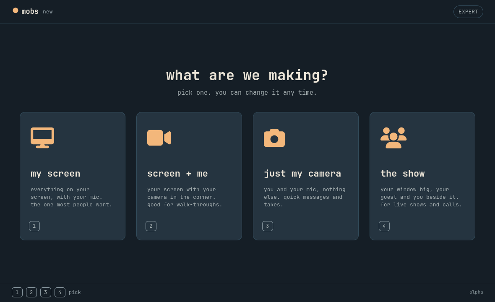
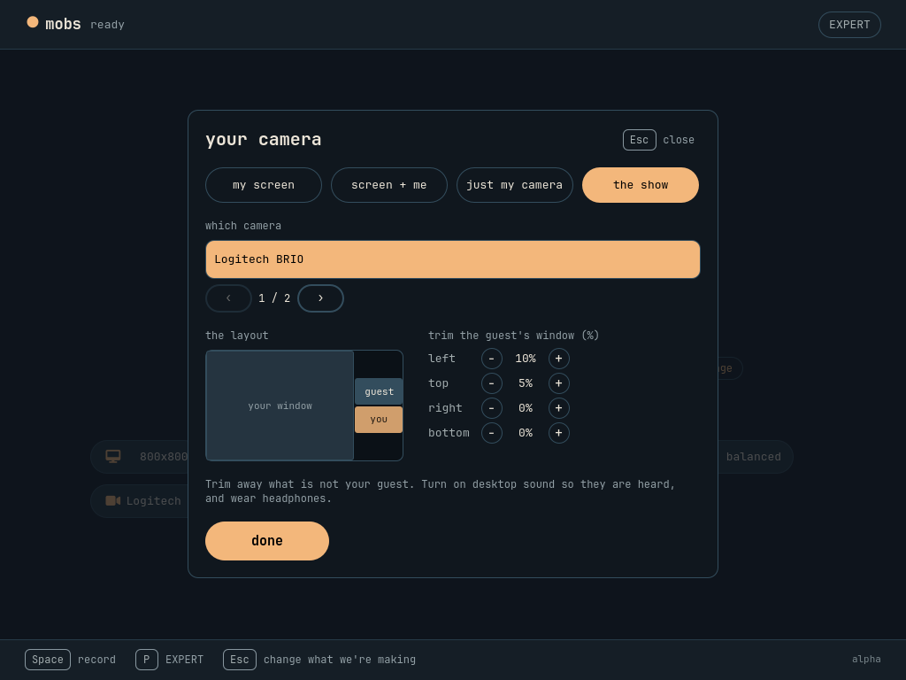
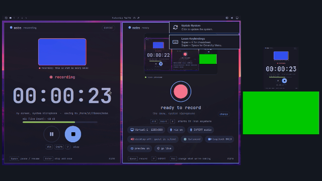

# MOBS app

MOBS's own window (ADR 0005). Qt 6 Quick, GPLv2. It reuses Monologue's `theme.cpp` **by path** from
`../../monologue/src`, so subtree pulls keep updating it.

**What works now:** the choose, ready and recording screens; the live Omarchy theme (full palette, Hyprland rounding,
theme switches, contrast guard); your pick remembered; the real display name; and **real recording with libobs inside
this process** (ADR 0006): Space or the red button starts, Space pauses and resumes, Enter stops and saves an MP4
(H.264 + AAC) under `~/Videos/mobs`. The first screen recording opens the system's screen picker once; MOBS saves the
restore token itself (`~/.config/mobs/screen-token`), so later recordings are silent. **Cameras (2026-10-10):** the camera chip on the ready screen opens a panel: switch between *my screen*, *screen + me* and
*just my camera*; pick a webcam from the ones found under `/dev/v4l/by-id` (named from the system; the stable id survives
`/dev/videoN` renumbering); for *screen + me*, tap a corner of a mini screen and choose small, medium or large. The
diagram and the recording use the same rectangle (`src/placement.h`). The choice is remembered. MOBS asks the camera for 1280x720
MJPEG when it supports it.

**Live preview (2026-10-10):** the *preview* chip on the ready screen shows what will be recorded, live (15 frames per second, 640x360):
your screen, and your webcam where you placed it. It follows the choices as you make them (tap a corner and the webcam moves in the
preview), keeps running during a recording, and is **off by default and remembered**, because it turns the camera on and may open
the screen dialog. Frames come out of libobs as plain pictures (`obs_add_raw_video_callback2`), not a native surface inside the
window, which is simple, robust on Wayland, and testable by reading pixels.

**Review (2026-10-10):** when a recording is saved, MOBS opens it for review by itself: watch it (plays only the parts you keep,
hopping over cuts), and trim and cut on **Monologue's own timeline editor** (`EditBar.qml`, used unmodified from the subtree): drag
a handle to trim, double-click to split, click x to cut a part out, with a white mark wherever you paused. **save edit** writes
`<name> (edited).mp4` beside the original (never overwriting, never touching the original; encoded to a hidden partial file and
renamed into place); **done** leaves (asking first if there are unsaved edits); **delete take** moves it to the trash (asks first).
Keys: Space play, S split, X cut or restore, Left/Right and Shift/Alt nudges, [ ] jump between marks, Z zoom, Ctrl+Z / Ctrl+Y undo and redo,
Ctrl+S save, Esc done. The pause marks come from `<take>.mobs.json`, written when you stop recording.

**EXPERT:** the header button (or P) opens focused recording, encoding, audio, keys, about and hardware pages. Choose a plain quality preset or set custom x264 CRF / CPU preset; change the save folder explicitly with **use folder**. Software encoding is the default; the hardware page checks NVIDIA H.264 availability before you choose it. NVIDIA uses CQP quality and the p5 preset. Settings apply to the next recording. Closing during a recording stops and saves; unsaved edits and active exports are protected. See [the usability and reliability report](../../docs/quality-and-expert.md) for fixes, tests and the next settings to add.

**Audio:** ready shows the chosen microphone, a mic toggle and a desktop-sound toggle. **EXPERT audio** selects a named input or output, offers an explicit **check mic** with a live meter, and has an **EXPERT gain** page for independent −60 to +12 dB adjustments. Mic checking captures without saving or playing sound. Desktop levels appear during recording; both sources mix into one AAC track. Microphone defaults on at 0 dB, desktop off at −6 dB. Device discovery requires `pactl` and a compatible PulseAudio service (including PipeWire's PulseAudio service). Missing inputs block recording with an explanation; turning both inputs off permits a silent take.

Review loading keeps the window responsive and explains inspection failures on Ready. If saving a recording stalls, close the window again to choose **keep waiting** or **quit without waiting**. Quitting without waiting may leave that recording incomplete or unplayable; normal close still waits for a save.

The editor keeps picture warnings and export failures visible together and fits its confirmations in a small window. Camera selection uses arrows to browse named devices, keeping placement controls and Done visible even with several cameras connected.

Architecture: `Engine` (state machine for QML) drives a `RecorderBackend` (a narrow interface: begin, pause, end).
The only real backend is `ObsBackend` (libobs); tests use a fake one. Keeping that door small is what would let the engine
be swapped for another language later (Fred chose C++17 + QML first, 2026-10-09).

## Seeing what is being recorded

**The picture is on by default** (the "preview" chip turns it off, and it is remembered), so the ready screen already shows what a take, or a
broadcast, will look like before you press anything. **Arming to go live always turns it on**, whatever the chip says: what is about to be broadcast is
seen first. While a take is recording or paused, the recording screen shows **the live picture MOBS is saving**, whether or not the ready screen's
"preview" chip was on. The webcam sits in the **top-right** corner by default (tap a corner in the camera panel to move it). It is the same scene the encoder reads (screen, plus your camera in its corner, or just the camera), at 15 frames a
second. A red outline and the line "recording: this is what is being saved" tell you it is live; **pause** dims it and says "paused: nothing is being
saved"; while the file is finished it stays, dimmed, under "saving...". Wide windows put the picture beside the timer and buttons, tall
ones put it above them; nothing scrolls (Law 17).

- The rule lives in `Engine::applyPreview`: preview = (what the ready screen asked for) OR (recording or paused). It is applied on the change to
  or from recording, never while MOBS is still waiting for the screen picker (so a second copy of the scene cannot race the recording's own).
- The ready screen's own choice is untouched: if the preview was on before the take it is on after, if it was off it goes back off (and the scene,
  with the camera, is released as soon as the take is saved).
- **Recording the screen MOBS is on shows a tunnel.** If the captured screen includes MOBS's own window, the picture shows MOBS showing the picture, and so on.
  That is what is actually being recorded. Pick a window, or keep MOBS on another monitor or workspace, to avoid it.
- The picture is 640x360 (a monitor, not a magnifier): enough to see layout, camera placement and whether anything is black.


## The opening screen

MOBS opens on a 2.8 s opening screen (`qml/SplashScreen.qml`), then fades into the app. One clock drives it, so every frame is a pure
function of time: the three viewfinder corners snap in, the record ring draws itself round with a bright head, the dot goes live
(pop, shockwave, then it breathes), the webcam lens opens in the corner where MOBS puts your camera and blinks, `MOBS` decodes letter by letter
with a cyan/red split as each letter lands, and a readout reports what this machine actually has: the libobs version, the display, the cameras found,
the microphone, and where recordings go. Every colour comes from the live Omarchy theme (checked on light, neon and orange themes).

- **Any key or click skips it.** The key is eaten, so a Space pressed during the opening screen can never start a recording.
- **A recording that starts (the hotkey launching MOBS) dismisses it at once.**
- **Off switch:** EXPERT > recording > *play the opening animation* (decided at launch; flipping it later never makes it appear mid-session).
- Scripted runs and `MOBS_GRAB` screenshots skip it, so they land on the real screens. For its own checks: `MOBS_SPLASH=1` plays it in a scripted run,
  `MOBS_SPLASH_AT=MS` freezes it at that moment (design checks, screenshots), `MOBS_SPLASH=0` forces it off.


## Screen and me: the simple way

**The first run goes straight to "screen + me"** (or "my screen" when no camera is found): no four cards to puzzle over. The picks are one tap away (the "change" pill on
the ready screen).

- **It shares a whole screen, never a window or a dragged region.** "My screen" and "screen + me" ask the portal for monitors only (OBS's `pipewire-desktop-capture-source`),
  so you can **change workspaces and the stream follows**. A window or a region was what once made half a picture and a black rest. Only "the show" may pick a window.
  The choice is remembered (`~/.config/mobs/screen-token-desktop`); **the screen chip on the ready screen ("eDP-1 1920x1080 (change)")** forgets it and asks again.
- **Drag your webcam, even while you are live.** Over the live picture, press on the webcam and drag it anywhere inside the frame; it moves in the broadcast as you move it,
  so you can uncover whatever was under it and put it back (or tap a corner in the camera panel to snap it there). Releasing remembers the place. The default is the **top-right** corner.
  Dragging is applied by the backend in the middle of a take (`ObsBackend::applyPlacement` no longer waits for the take to end); it is only for "screen + me".
- **GO LIVE to X is always a bold red button** beside Record, whether or not a stream key is saved: without one it opens EXPERT > live (the key is per machine).

## The log

MOBS now **always keeps a log**: `~/.local/state/mobs/mobs.log` (`MOBS_LOG_FILE` overrides; EXPERT > about shows the path). It is the first thing to read when something looks wrong.
It keeps what the journal throws away: libobs's informational lines (never its per-frame debug ones), Qt's own warnings, what MOBS found at start (monitors with sizes and
positions, cameras, settings), **the size of every picture it captures** ("screen source is 1920x1080 (whole screen)", "camera source is 1280x720"), every recorder state,
every stream state with its reason, the stream's bitrate and dropped frames every 10 s, picks, the webcam being dragged, hotkey presses, and each take's start line.
**The stream key is never written**: it is registered as a secret the moment a broadcast starts and replaced by `***` in every line, whoever prints it (Qt, libobs, MOBS).
Mode 0600; at 4 MB it rotates to `mobs.log.1` and `.2`.

## The show: your window, a guest and you

A fourth pick on the first screen (key **4**): **the show**, laid out like a video call's gallery. **Your shared window big on the left** (a terminal, say), and on the
right two tiles, **your guest above and you (your webcam) below**, on a quiet dark backdrop. It exists for live shows and calls: pick it, then go live to X
(see below) and viewers see exactly this.

- **Where the guest comes from.** X has no native video guests (its Live has one broadcaster; Spaces are audio only), so the guest joins a call in whatever
  tool you use (Riverside, Meet, Zoom, a browser tab) and MOBS captures **that call window** into the guest tile. That works with any tool.
- **Two dialogs, one after the other.** The first asks for your main window (the terminal) and the second, only once the first is done, for your guest's window
  (so two pickers never compete). Each choice is remembered (`~/.config/mobs/screen-token` and `screen-token-guest`), so the next launch asks for neither
  as long as those windows exist.
- **Trim what is not the guest.** A call window usually shows you too, so the camera panel (the camera chip) has "trim the guest's window": percent off each
  edge in 5 % steps (left, top, right, bottom; opposite edges can never take more than 90 % together, and the trim is a percentage so it survives the window being
  resized). The picture is never stretched: a window that is not 16:9 sits centred in its tile with backdrop beside it. A pop-out that shows only the guest needs no trim.
- **The guest's voice is desktop sound.** Window capture has no audio, so turn on **desktop sound** (the ready screen's chip goes red and says "guest is silent"
  while it is off) and **wear headphones**, or the guest comes out of your speakers into your mic.
- The layout is one definition (`Placement::showLayout`): a 1920x1080 canvas, the right column a quarter wide, tiles 16:9, the guest above you. The live picture,
  the recording and the broadcast all show it; the camera panel's diagram is drawn from the same rectangles.





Tested: three real-libobs scenarios (`tst_obsbackend`): the layout on the encoded pixels (window red on the left, guest blue top right, you green below,
backdrop above and below, nothing spilling between tiles) and the trim on a guest video that is half red, half blue (untrimmed: both halves; trimmed: none of the red,
bars of backdrop either side, not stretched). The two-dialog sequence and the saved tokens were checked in the practice VM against the REAL portal with a scripted
picker (xdph's `custom_picker_binary` answering the first dialog with the screen and the second with a window): two dialogs, in order, both tokens saved, and a second
launch asked for none. **Not tested:** a real call with a real guest; the guest window's own audio path; the first live broadcast of the show to X.

## Going live to X

MOBS can broadcast a take to X (or any RTMP/RTMPS server) while it records. **The saved file is always the full-quality 1080p copy**, whatever happens
to the broadcast; the stream is a second, constant-bitrate encode of the same picture and sound.

**Set it up once** (EXPERT > live): **the address is already filled in** (`rtmp://va.pscp.tv:80/x`, what X's Live Studio shows for US East; change it for another
region or `rtmps://va.pscp.tv:443/x` for encryption), so **only the stream key has to be pasted** (studio.x.com/live > New livestream > RTMP; X may need Premium and
Live Studio is in beta, so check X's page). The quality defaults to **X recommended**, the "recommended" column of X's own encoder panel: **H.264, 1920x1080, 30 fps,
9 Mbps, AAC 128 kbps stereo at 44.1 kHz, a keyframe every 3 seconds**. Lighter choices: light (720p, 3 Mbps) and standard (1080p, 6 Mbps).
**The stream key is a password.** It is kept in its own owner-only file (`~/.config/mobs/stream-key`, mode 0600), never in the settings file, never shown
again after saving, never printed, and scrubbed out of any error text. QML has no way to read it back. Once saved, the page says so and has a **close EXPERT** button.

**To start:** on the ready screen press the red **GO LIVE to X** button beside the Record circle. One click arms the broadcast and starts the take (with no key saved yet
the same button reads "set up go live" and opens EXPERT > live). **Going live is a deliberate step every time**; the other way is the **go live** chip, which arms it for
Record or the hotkey instead. It turns red
("LIVE: armed"), the title reads "ready to go LIVE" and a red line says "Record BROADCASTS to X: this screen is public until you stop." Then Record. Arming is
never remembered: it clears when the take ends, when MOBS restarts, and by itself after 15 minutes if no take starts.

**While live** the recording screen shows a LIVE pill (CONNECTING, LIVE, RECONNECTING, or a red outlined NOT LIVE), the bitrate and any dropped frames, and the
header says LIVE. **Pause is off while you broadcast**: viewers would keep watching while the saved file skipped that stretch.

- **If the stream fails the recording does not.** A refused key or address, or a lost connection after 10 retries (the waits grow from 2 s to about 77 s: roughly four minutes), shows "NOT LIVE: the
  server did not accept the address or stream key. The recording is still being saved." and the take carries on to its file. A dropped connection is retried
  first (RECONNECTING). Once the stream is gone, pause works again.
- A stream that cannot even start (no encoder) stops the take before it begins, with the reason, instead of a take that quietly never went live.
- The broadcast uses its own registered stream target (`mobs_rtmp` in `obsbackend.cpp`) and not OBS's `rtmp-services` module, because that module asks
  obsproject.com for a service list every time it loads. MOBS never phones home.
- The stream encoder is x264 (veryfast, constant bitrate, keyframe every 3 s) or NVIDIA H.264 when the hardware page says so, plus AAC at 128 kbps: the settings X
  recommends in Live Studio (H.264 + AAC-LC at 44.1 kHz, 9 Mbps, 1080p30, keyframe every 3 s). MOBS now runs its audio engine at 44.1 kHz for that.
- Quitting the window while live stops the take, and with it the broadcast, the same as Stop.


Tested without X: a stand-in server (`ffmpeg -listen 1 -i rtmp://127.0.0.1:PORT/live/KEY`) on this machine. `tst_obsbackend` has three real-libobs scenarios
(a broadcast the server receives and decodes: H.264 + AAC, size, keyframe spacing, tone present, and the full-quality file beside it; a broadcast to a port
nobody listens on, which must say so and leave the file alone; and a take that did not ask for one, which creates nothing) plus a hardware one on a
machine with NVIDIA H.264. The first real broadcast to X is Fred's to start, because it goes to his followers.

## Install: launcher entry, icon, hotkey launch

```sh
cmake --install build --prefix ~/.local     # binary, launcher entry, icon, D-Bus launch file
```

MOBS then shows up in the launcher (SUPER+SPACE, Omalaunch reads `.desktop` files live) as **MOBS** with its icon
(`dist/mobs.svg`: a record ring and dot, viewfinder corners, and a webcam lens in the bottom-right where MOBS puts your
webcam). Right-clicking offers *Start or stop recording* and *Pause or resume*. A test installs into a temporary folder
and checks the paths and that the installed binary starts and draws, because an earlier build only worked next to its
build folder. Re-run the command after rebuilding.

**Getting back to the three choices (my screen / screen + me / just my camera):** click **change** next to the mode text on the
ready screen, press **Esc**, or click the camera chip. They are shown full-screen on first run only.

## The hotkey (physical Alt + Shift + V)

MOBS exports `org.mobs.Control` on the session bus: `Toggle` (start, or stop and save), `Pause` (pause or resume) and
`Status`. A Hyprland bind runs one command from any application:

```sh
busctl --user call org.mobs.Control /org/mobs/Control org.mobs.Control Toggle     # SUPER + SHIFT + V  (physical Alt + Shift + V)
busctl --user call org.mobs.Control /org/mobs/Control org.mobs.Control Pause      # SUPER + CTRL + SHIFT + V
```

If MOBS is not running, D-Bus starts it: copy `dist/org.mobs.Control.service` to `~/.local/share/dbus-1/services/`, replace
`@MOBS_BIN@` with the path of the `mobs` binary, and reload the bus once (or log in again). Proven in the Test Drive VM:
Toggle, Pause, Pause, Toggle made a valid file with the pause cut out; auto-launch started MOBS in 0.5 s; a second copy does not take
the hotkey over. (`MOBS_NO_HOTKEY=1` stops a copy from registering.)

```sh
cmake -S . -B build -G Ninja && cmake --build build
QT_QPA_PLATFORMTHEME=generic QT_QUICK_BACKEND=software QT_QPA_PLATFORM=offscreen ctest --test-dir build --output-on-failure   # unit tests, no window appears
# real libobs recording test (needs a Wayland session, e.g. the Test Drive VM):
QT_QPA_PLATFORM=wayland MOBS_LIBOBS_TEST=1 ./build/tst_obsbackend
./build/mobs
```

Native integration runs each scenario in a separate process, matching the app's single libobs lifetime. The installed OBS NVIDIA plugin cannot reliably unload and reload in one process; repeated takes and NVIDIA/software switching are tested within a single backend. CMake copies and installs the system `obs-nvenc-test` helper alongside MOBS when available, as the NVIDIA plugin expects it there.

Test and screenshot switches (env vars): `MOBS_THEME_DIR` (a fake Omarchy "current" folder), `MOBS_SETTINGS` (settings file),
`MOBS_SCREEN=1` / `MOBS_PICK=1..3` (start screen), `MOBS_WINDOW_SIZE=860x560`, `MOBS_GRAB=/path.png` (save the window's own pixels and quit), `MOBS_TEST_SOURCE=colour` (record a test colour instead of the screen, no picker), `MOBS_REC_DIR`, `MOBS_TOKEN_FILE`, `MOBS_TEST_CAMERA=colour` (a green stand-in webcam), `MOBS_FAKE_CAMERAS=1` (two sample cameras for screenshots), `MOBS_NO_HOTKEY=1`, `MOBS_VERBOSE=1` (libobs logs warnings and errors only otherwise). Script steps also include `pick=N`, `corner=N`, `size=N`, `panel=0/1`, `preview=0/1`, `grabpreview=`, `review=`, `split=`, `cut=`, `savereview`, `waitsaved`, `closereview`, `pro=0/1`, `tab=0..5`, `checklayout`, `key=P/Space/Esc`, `focusfolder`, `foldertext=`, `applyfolder`, `closewindow`, and `expect=state:idle` (also `pro`, `screen`, `confirmQuit`, `folderDefault`). Script `quit` explicitly exits without asking about unsaved test edits.

Script condition `expect=previewing:0|1` reads whether the live picture is running (the fake backend serves a flat colour frame for it).
The show: `MOBS_TEST_GUEST=colour` (a blue stand-in) or `video:/path.mp4` (a file) replaces the guest's window dialog in tests; `MOBS_TEST_GUEST_COLOUR` sets the colour. Script step `guestcrop=EDGE:PERCENT` (0 left, 1 top, 2 right, 3 bottom), `click=NAME` also finds items a Repeater made, and `expect=guestCrop:L/T/R/B`.
Logging: `MOBS_LOG_FILE=/path` (tests use a throwaway one). Dragging: script steps `dragcam=DX:DY` (a real press, move and release on the webcam handle), `movecam=X:Y` (0..1), and `expect=camMoved:0|1`.
Mock-ups: `MOBS_FAKE_PREVIEW=/path.png` (fake backend only) serves that picture in the live preview, so the REAL window can be drawn with a stand-in picture inside it (see `docs/app/mockup-golive-board.png`: stand-in desktop and webcam, real layout, corner and windows).
Going-live switches: `MOBS_STREAM_KEY_FILE` (where the key is kept; scripted runs use a throwaway one). Script steps `arm=0/1`, `streamurl=`, `streamkey=`, `streamquality=N`, and with the fake backend `streamdrop` / `streamretry` / `streamback`; conditions `expect=armed|broadcasting|streamReady:0|1`, `expect=streamState:live` and `expect=streamProblem:text`. EXPERT tab 6 is the live page (`tab=0..6`).
Opening-screen switches: `MOBS_SPLASH=1|0`, `MOBS_SPLASH_AT=MS` (see "The opening screen"); the `expect=splashDone:0|1` script condition reads whether it has finished.
Audio test switches: `MOBS_FAKE_AUDIO=1` lists demo inputs; `MOBS_TEST_AUDIO=file:/path.wav` and `MOBS_TEST_DESKTOP_AUDIO=file:/path.wav` supply generated sound to native tests. `MOBS_FAKE_BACKEND=1` is accepted only with `MOBS_SCRIPT` and exercises QML without capture. EXPERT tabs are `tab=0..5`; scripts also support `openaudio`, `audiodetails=0/1`, `micdevice=`, `desktop=0/1`, `miccheck=0/1`, `micgain=`, and `hardware=0/1`.

Layout: `src/palette.*` (theme reader), `src/appstate.*` (screens and pick), `qml/` (components and screens), `tests/`.
Screens are checked in the Test Drive practice VM, never on a live desktop; see `docs/app/`.
