# MOBS app

MOBS's own window (ADR 0005). Qt 6 Quick, GPLv2. It reuses Monologue's `theme.cpp` **by path** from
`../../monologue/src`, so subtree pulls keep updating it.

**What works now:** the choose, ready and recording screens; the live Omarchy theme (full palette, Hyprland rounding,
theme switches, contrast guard); your pick remembered; the real display name; and **real recording with libobs inside
this process** (ADR 0006): Space or the red button starts, Space pauses and resumes, Enter stops and saves an MP4
(H.264 + AAC) under `~/Videos/mobs`. The first screen recording opens the system's screen picker once; MOBS saves the
restore token itself (`~/.config/mobs/screen-token`), so later recordings are silent. **Cameras (2026-10-10):** the camera chip on the ready screen opens a panel: switch between *my screen*, *screen + me* and
*just my camera*; pick a webcam from the ones found under `/dev/v4l/by-id` (named from the system; the stable id survives
`/dev/videoN` renumbering); for *screen + me*, tap a corner of a mini screen and choose small, medium or large. The
diagram and the recording use the same rectangle (`src/placement.h`). The choice is remembered. MOBS asks the camera for 1280x720
MJPEG when it supports it.

**Live preview (2026-10-10):** the *preview* chip on the ready screen shows what will be recorded, live (15 frames per second, 640x360):
your screen, and your webcam where you placed it. It follows the choices as you make them (tap a corner and the webcam moves in the
preview), keeps running during a recording, and is **off by default and remembered**, because it turns the camera on and may open
the screen dialog. Frames come out of libobs as plain pictures (`obs_add_raw_video_callback2`), not a native surface inside the
window, which is simple, robust on Wayland, and testable by reading pixels.

**Review (2026-10-10):** when a recording is saved, MOBS opens it for review by itself: watch it (plays only the parts you keep,
hopping over cuts), and trim and cut on **Monologue's own timeline editor** (`EditBar.qml`, used unmodified from the subtree): drag
a handle to trim, double-click to split, click x to cut a part out, with a white mark wherever you paused. **save edit** writes
`<name> (edited).mp4` beside the original (never overwriting, never touching the original; encoded to a hidden partial file and
renamed into place); **done** leaves (asking first if there are unsaved edits); **delete take** moves it to the trash (asks first).
Keys: Space play, S split, X cut or restore, Left/Right and Shift/Alt nudges, [ ] jump between marks, Z zoom, Ctrl+Z / Ctrl+Y undo and redo,
Ctrl+S save, Esc done. The pause marks come from `<take>.mobs.json`, written when you stop recording.

**EXPERT:** the header button (or P) opens focused recording, encoding, audio, keys, about and hardware pages. Choose a plain quality preset or set custom x264 CRF / CPU preset; change the save folder explicitly with **use folder**. Software encoding is the default; the hardware page checks NVIDIA H.264 availability before you choose it. NVIDIA uses CQP quality and the p5 preset. Settings apply to the next recording. Closing during a recording stops and saves; unsaved edits and active exports are protected. See [the usability and reliability report](../../docs/quality-and-expert.md) for fixes, tests and the next settings to add.

**Audio:** ready shows the chosen microphone, a mic toggle and a desktop-sound toggle. **EXPERT audio** selects a named input or output, offers an explicit **check mic** with a live meter, and has an **EXPERT gain** page for independent −60 to +12 dB adjustments. Mic checking captures without saving or playing sound. Desktop levels appear during recording; both sources mix into one AAC track. Microphone defaults on at 0 dB, desktop off at −6 dB. Device discovery requires `pactl` and a compatible PulseAudio service (including PipeWire's PulseAudio service). Missing inputs block recording with an explanation; turning both inputs off permits a silent take.

Review loading keeps the window responsive and explains inspection failures on Ready. If saving a recording stalls, close the window again to choose **keep waiting** or **quit without waiting**. Quitting without waiting may leave that recording incomplete or unplayable; normal close still waits for a save.

The editor keeps picture warnings and export failures visible together and fits its confirmations in a small window. Camera selection uses arrows to browse named devices, keeping placement controls and Done visible even with several cameras connected.

Architecture: `Engine` (state machine for QML) drives a `RecorderBackend` (a narrow interface: begin, pause, end).
The only real backend is `ObsBackend` (libobs); tests use a fake one. Keeping that door small is what would let the engine
be swapped for another language later (Fred chose C++17 + QML first, 2026-10-09).

## Seeing what is being recorded

**The picture is on by default** (the "preview" chip turns it off, and it is remembered), so the ready screen already shows what a take, or a
broadcast, will look like before you press anything. **Arming to go live always turns it on**, whatever the chip says: what is about to be broadcast is
seen first. While a take is recording or paused, the recording screen shows **the live picture MOBS is saving**, whether or not the ready screen's
"preview" chip was on. The webcam sits in the **top-right** corner by default (tap a corner in the camera panel to move it). It is the same scene the encoder reads (screen, plus your camera in its corner, or just the camera), at 15 frames a
second. A red outline and the line "recording: this is what is being saved" tell you it is live; **pause** dims it and says "paused: nothing is being
saved"; while the file is finished it stays, dimmed, under "saving...". Wide windows put the picture beside the timer and buttons, tall
ones put it above them; nothing scrolls (Law 17).

- The rule lives in `Engine::applyPreview`: preview = (what the ready screen asked for) OR (recording or paused). It is applied on the change to
  or from recording, never while MOBS is still waiting for the screen picker (so a second copy of the scene cannot race the recording's own).
- The ready screen's own choice is untouched: if the preview was on before the take it is on after, if it was off it goes back off (and the scene,
  with the camera, is released as soon as the take is saved).
- **Recording the screen MOBS is on shows a tunnel.** If the captured screen includes MOBS's own window, the picture shows MOBS showing the picture, and so on.
  That is what is actually being recorded. Pick a window, or keep MOBS on another monitor or workspace, to avoid it.
- The picture is 640x360 (a monitor, not a magnifier): enough to see layout, camera placement and whether anything is black.

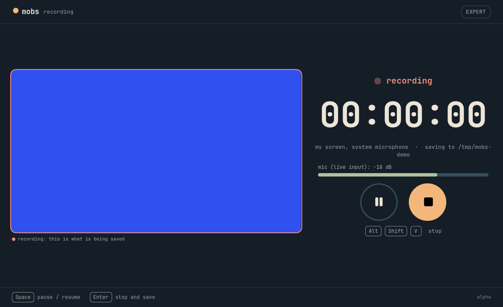
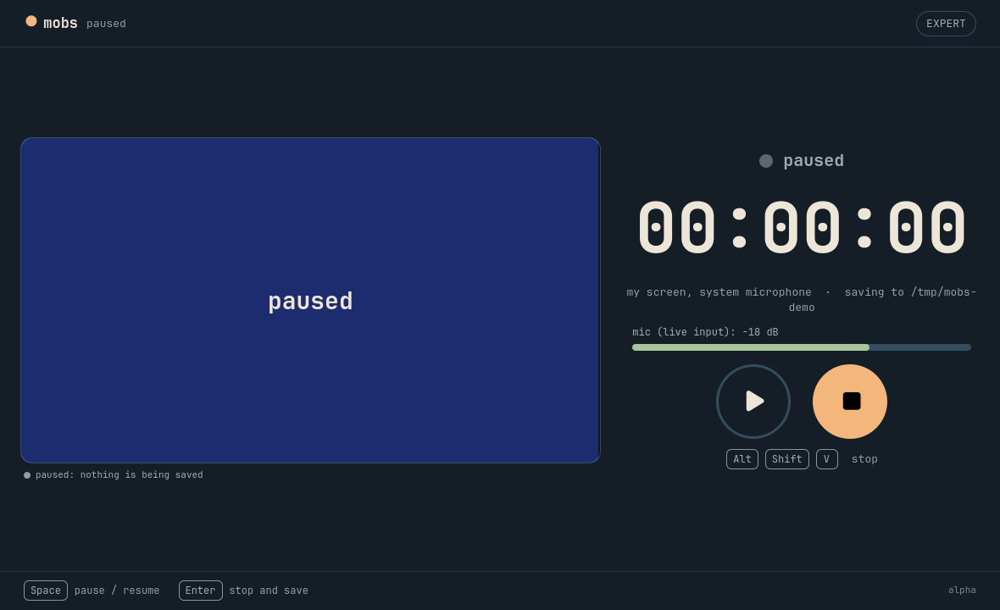


## The opening screen

MOBS opens on a 2.8 s opening screen (`qml/SplashScreen.qml`), then fades into the app. One clock drives it, so every frame is a pure
function of time: the three viewfinder corners snap in, the record ring draws itself round with a bright head, the dot goes live
(pop, shockwave, then it breathes), the webcam lens opens in the corner where MOBS puts your camera and blinks, `MOBS` decodes letter by letter
with a cyan/red split as each letter lands, and a readout reports what this machine actually has: the libobs version, the display, the cameras found,
the microphone, and where recordings go. Every colour comes from the live Omarchy theme (checked on light, neon and orange themes).

- **Any key or click skips it.** The key is eaten, so a Space pressed during the opening screen can never start a recording.
- **A recording that starts (the hotkey launching MOBS) dismisses it at once.**
- **Off switch:** EXPERT > recording > *play the opening animation* (decided at launch; flipping it later never makes it appear mid-session).
- Scripted runs and `MOBS_GRAB` screenshots skip it, so they land on the real screens. For its own checks: `MOBS_SPLASH=1` plays it in a scripted run,
  `MOBS_SPLASH_AT=MS` freezes it at that moment (design checks, screenshots), `MOBS_SPLASH=0` forces it off.


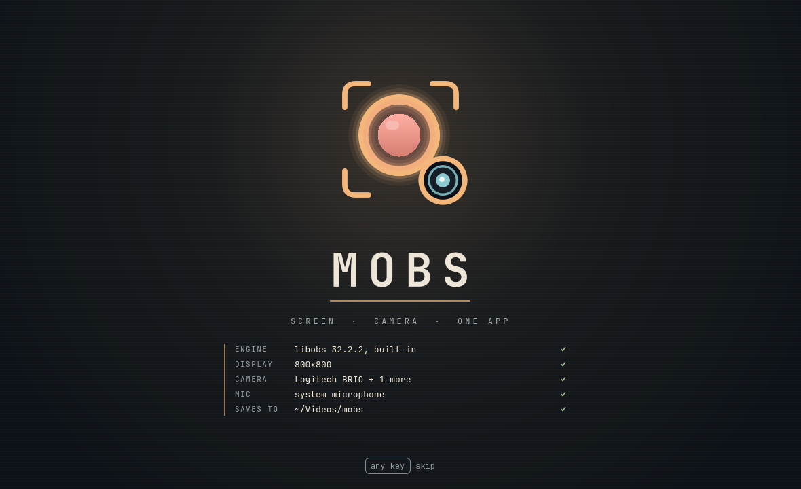
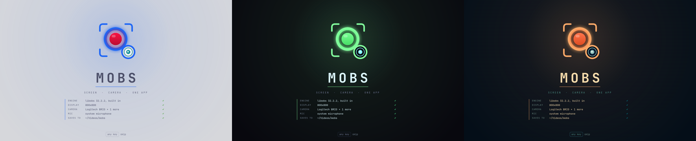

## Easy mode: a guide that clicks through to live on X (2026-10-12)

Fred, 2026-10-12: "everything should be made for EASY mode ... pick my camera/mic and lock it in as the default ... it should not ask me what region, it should do the entire
workspace and follow me ... click follow next, click follow instructions, next all the way to live streaming on X." So the app does the explaining, with real pictures, and the
person only presses NEXT.

- **The text is big, and it grows with the window** (Fred, 2026-10-13: "the text in the app is about 4 sizes too small... all things in the app should be EASY MODE"). The whole interface (every screen, the guide, the
  go-live window, EXPERT, the editor and the opening screen) is drawn on a canvas that is never smaller than 860 by 560 and is **scaled up to fill the window** (`uiScale` in `qml/Main.qml`: 1 at 860 by 560,
  1.29 at 1180 by 720, 1.68 at 1500 by 940, at most 3). Tiled on a 5120 pixel wide screen the 13 pixel text used to stay 13 pixels; now it is about 39. A window that floats opens at 1500 by 940 (never more
  than 90% of the screen). Nothing is cut off and nothing scrolls, because the canvas keeps the shape of the window. The pages of the X boxes are drawn at real screen pixels and shrunk back
  (`qml/StudioFrame.qml`), so X's own text stays sharp. The webcam window is a window of its own and is not scaled. Tests: the scale at seven window sizes, and `checktext=N` (no text showing is smaller than
  N pixels after the scale: 15 at 1180 by 720, 19 at 1500 by 940) on the ready screen, EXPERT, every guide page, the recording screen and the go-live window.
- **The setup guide** (`qml/SetupGuide.qml`, one page per file `qml/Setup*.qml`) opens by itself the first time MOBS runs. It has 8 pages: welcome, camera, microphone, your screen, your
  webcam, **your X account**, going live, all set. **NEXT** (or Enter or Space) is on every page and is greyed until the page's job is done or skipped; Back, Left and Esc
  go back; "skip the guide" leaves. MOBS remembers the page you stopped on (`setupStep`) and opens there next time; finishing sets `setupDone`, so it never opens by itself again.
  Every red mark on the ready screen opens the guide at the page that fixes it.
- **Your X account is one page, and nothing is copied by hand** (`qml/SetupX.qml`, `qml/SourcePilot.qml`; Fred, 2026-10-13, after the manual source and key pages sent a fresh setup wrong). On the
  right is X's own Live Studio in MOBS's own browser. The person signs in there once (the password goes into X's page, MOBS never sees it). Then MOBS opens the **Sources** page, makes a source
  called MOBS if there is none, opens the key panel of the source, shows the key and **reads the stream key and the server address from X**. The key goes straight into the private key file, the
  address into the settings, and the name of the source is remembered. Reading the address from X matters: X's Create Source form starts on **US West (Oregon)**, while the address MOBS used to
  assume was Virginia, and a source in another region than the address MOBS sends to shows "Not connected" for ever. NEXT opens when the key is saved. If MOBS cannot read the key it says why and
  offers to paste it; "skip" leaves X for later. The same sign-in is what shows the chat under the webcam. The page half of this is `assets/pilot/xstudio-pilot.js`, matched by X's own words, labels and
  roles (read from the real page on 2026-10-13), never by generated class names.
- **Real pictures.** The X pages are crops of real Live Studio screenshots (`assets/guide/`) with a red ring drawn on the thing to press (`qml/GuideImage.qml`).
- **The camera and the microphone are picked once and locked.** The camera page lists the cameras with a live picture; *lock this camera* saves it (`cameraLocked`, `cameraLockedName`) and it
  stays the default until the person changes it. A locked camera that is unplugged is never swapped for another: the ready screen says "<name> is unplugged". The microphone page has a level
  meter, *lock this microphone* saves the device (`micLocked`) and desktop sound is a switch on the same page. "System default microphone" is not a device, it follows whatever becomes the default
  later (a headset plugged in), so locking it stores the microphone that is the default at that moment (`AudioDevices::resolveDefault`); it stays "default" only when that cannot be named. Two
  identical webcams cannot be told apart by name: when the locked one is gone, the other is not taken for it.
- **The whole workspace, no region question.** The screen page asks once for a whole screen (never a window or a region), shows the real picture, and the stream follows every workspace
  change. *choose again* forgets the share.
- **The ready screen** is one big red **GO LIVE to X** button, a row of check marks (camera, microphone, screen, X, chat: green is done, red or yellow opens the guide at its page), *just record,
  nothing goes to X*, the hotkey chip and *more options* (EXPERT). With no stream key, GO LIVE opens the guide at the page that gets one.
- **After GO LIVE, MOBS goes live for you** (`qml/GoLiveGuide.qml`, `qml/LivePilot.qml`; Fred, 2026-10-13: "it wouldn't go live... it was confusing what to press and the GO LIVE didn't
  activate on the x.com, wouldn't UN GREY"). **Why Go Live stayed grey:** the **Title** of Live Studio's Create Livestream form was empty (X says so beside the button: "Add a title to go
  live."), and the old steps never mentioned a title; X fills it in only from the last livestream it still lists. Its rules, read from its own page code: Go Live needs a title, a source, and a source
  that is **on** (X looks at the source every 20 seconds, so that takes up to a minute after the video arrives). So the ready screen has a **title box** and an *everyone can watch / only me (test)*
  switch (`liveTitle`, `livePublic`: remembered, with a default title of "Live with MOBS"), and after GO LIVE MOBS keeps its own window up with **Live Studio in a box on the right** and does what a
  careful person would, one look at the page at a time: opens New Livestream, types the title, checks (and sets) who can watch, picks the source the person named, waits until X's own text says the
  source is on, presses Go Live, and takes the livestream's id from the address X moves to (`/live/<id>`), which attaches the chat under the webcam; a moment later MOBS's window steps out of the picture
  by itself. The left of the window says in plain words what is done and what MOBS waits for, and shows X's own sentence while Go Live is grey. If a step fails (X changed its page, an error toast, X
  never sees the video) it says so, the box becomes the person's, and the old steps, **I'M LIVE** and **STOP** are there. The helper matches X's own English words ("New Livestream", "Go Live", "Audience"): with X set to another language it cannot find them, says so, and hands the box over. `MOBS_NO_PILOT=1` turns the helper off (the window is the steps alone).
  Hold: 5 minutes at most (`MOBS_HOLD_MS`).
- **The chat, in the app.** On the guide's X page the person signs in to X **once**, in MOBS's own browser profile (`mobs-x`, cookies in `~/.config/mobs/web`, a folder to treat like a password; MOBS never sees the password; the sign-in is noticed when a page that finished loading is x.com/home; a person who is already signed in lands on Live Studio at once and a signed-out one is sent by X to its sign-in; Live Studio drawing its own page is what proves the sign-in). **Passkeys cannot work in this box**: X's sign-in page asks for one the moment it loads, a passkey lives on a phone or in a password manager that a small embedded browser cannot reach, and Qt's browser waits for an answer that never comes, so the page spun forever on Fred's first real run. MOBS now tells the page, before any of its code runs, that passkeys do not exist here (X then goes to the email, username and password way in) and cancels any passkey request that still arrives. Google and Apple sign-in need pop-up windows MOBS does not open, so the guide says to use email or username and password. Live Studio itself opens in the same box (it needs X Premium; if it does not open the page says that and still lets the person go on). During a take MOBS **finds the livestream by itself** (`qml/XLiveFinder.qml`): from the moment a broadcast starts connecting (not from "live": the list has to be read BEFORE the person can press Go Live, which they can only do once MOBS is connected) and while you are signed in, a browser only 2 pixels wide, behind the picture of the webcam, loads Live Studio's list, and the livestream under "Live Now" has a plain link in it (`/live/<id>`, seen on the real page); the link is read and the chat card under the webcam shows **that livestream's own Live Chat card**, read-only (`qml/XChatView.qml`). Which livestream is THIS broadcast's? What was already under "Live Now" when the broadcast began (a livestream that was never ended, or one X still lists just after it ended) is remembered first, once the list has been drawn and two looks agree, and only a NEW one is taken (two new ones at once are not guessed between: the go-live window asks the person to paste the right link, and says so too when the finder has given up); the chat model also refuses a link picked up from the clipboard to one of those, and says why, and never picks up a link that was already on the clipboard when the broadcast began (an old livestream's address); a link the person TYPES into the go-live box is taken even when it is on that list, because they have said which one it is, and a typed text that is not a livestream link is answered with why. The hidden browsers are muted, reload less and less often, keep their count across a reconnect, and are stopped and asked again when a page stays "loading" for 45 seconds. The chat card asks X's page again every 15 seconds while it has no Live Chat card to show (a page that failed to load, or one loaded before the person signed in somewhere else in MOBS), and shows a card that never holds still after 8 readings, where it is. The card ends at the newest message (X lists messages from the top and leaves the rest empty, which a short dock would otherwise show as blank), emoji-only messages count, and the part shown is a real mask, so nothing of the page below the card can show. If the list has no "Live Now" row yet (nobody has pressed Go Live), it looks again every few seconds for about a quarter of an hour. The copied link of the go-live window is the other way in: only a Live Studio or broadcast link is taken, and a box takes a pasted one.
  **Checked against the real Live Studio page** (2026-10-12, read-only, in the signed-in posting browser, not yet in MOBS's own browser): `x.com/i/live-studio/<id>` is only a shell around an iframe at `studio.x.com/live/<id>`, so MOBS loads the studio address itself. Below about 900 px wide X switches to a phone layout with the chat far down the page, so MOBS gives X's page a big hidden window (1400 by 1200 page pixels, the desktop layout) and shows only the card's part of it, scaled to the dock's width and anchored at the bottom so the newest messages show. The card is found by its heading ("Live Chat"), the box for typing is cut off the bottom, the page itself is never changed and MOBS reads no chat text from it. The cover over the card comes off only after two readings agree, so the whole page never flashes. If X asks for a sign-in the card says so; if the page has no chat card it says that. The card follows links only inside x.com and twitter.com and takes no clicks. The chat ends with the take. **Not yet seen**: the card with people chatting (the only livestream available to look at was an ended one with no messages) and a fresh MOBS profile's first visit to studio.x.com. The other route (a script on another computer posting to the relay, below) still works beside it.
- **Stopping the video does not end the livestream on X** (Fred's first real go-live: 62 viewers were watching a stream that had stopped; X ended it only when Fred pressed End livestream). When a take that was broadcasting stops, however it ends, and X had received the stream at some point in it, MOBS says so in a notice and opens that livestream in Live Studio (the list of livestreams when MOBS never found which one it was, with wording that does not claim viewers are watching); ending it there stays the person's button. A broadcast that never connected (a wrong key, no network) left nothing open on X, so it says nothing and opens nothing. The going-live window also says that Live Studio's player starts muted (Fred first thought the audio had dropped; MOBS had recorded the BRIO microphone and the desktop sound, the saved file had a normal audio track, and the player was muted); with "also share my computer's sound" on, it says to leave the player muted instead, because the player would play the broadcast's own sound back into it.
- **Guests are not here.** X has no way to bring a watching viewer on stream (STATUS.md, "Guests abandoned").
- **Tests and hooks.** Unit tests for the settings, the app state and the Live Studio link parser; `check_ui.py` walks all 8 pages, checks that every page fits at 860x560, 1024x768 and 1180x720,
  and runs the chat crop against the stand-in page; `MOBS_UI_KEEP_GOING=1` lists every failing scenario at once. Environment: `MOBS_SETUP=0|1`, `MOBS_NO_OPEN=1` (log instead of opening a
  browser), `MOBS_HOLD_MS`, `MOBS_WEB_DIR`, `MOBS_X_LOGIN_URL`, `MOBS_X_STUDIO_URL`, `MOBS_X_SOURCES_URL`, `MOBS_NO_PILOT=1` (the go-live helper off), `MOBS_PILOT_TICK_MS` (how often it looks at the page), `MOBS_PILOT_WAIT_MS` (how long it waits for X to say it sees the video), `MOBS_FAKE_MORE_MICS=N` (more stand-in microphones), `MOBS_X_CHAT_URL`, `MOBS_X_TRIES` (how many looks before the chat card is called missing). Script steps: `setupstep=`, `xurl=`, `xattach=`, `closepip`, `grab=`.

The guide, page by page (offscreen run with stand-in devices, a fake key and a stand-in Live Studio page in the box, `docs/app/easy-*.png`; the picture on the how-it-works page is a real crop of Live Studio):

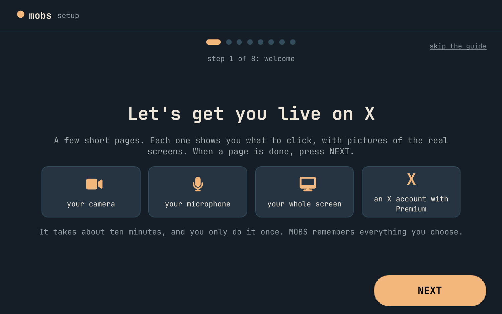
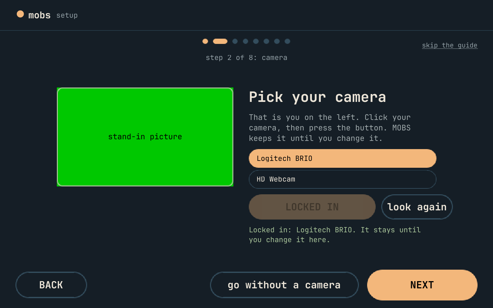
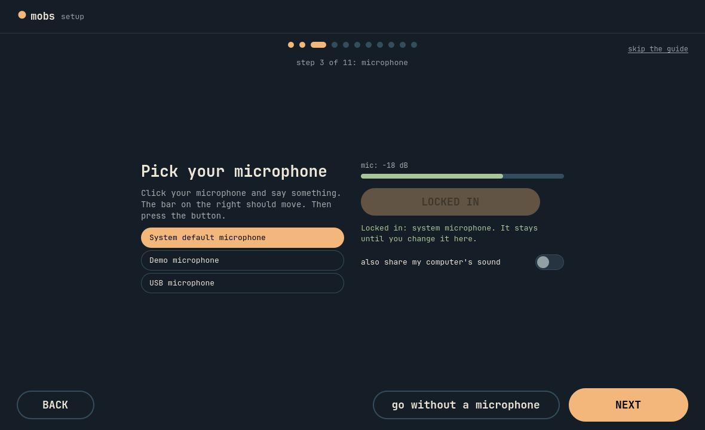
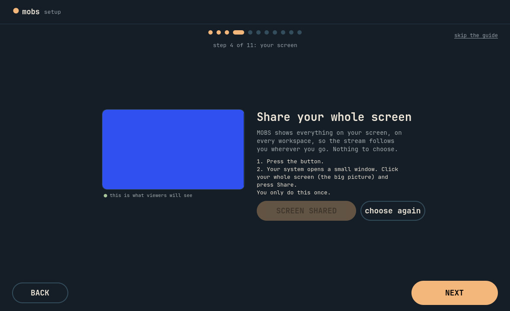
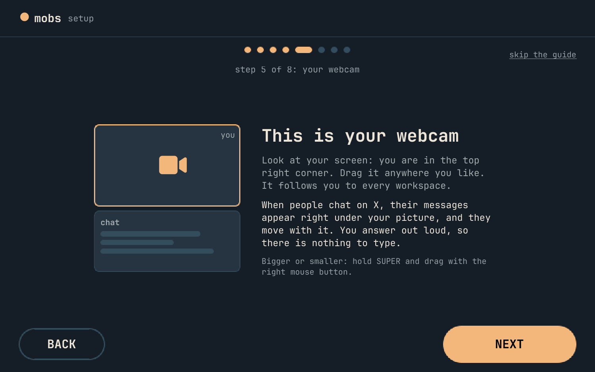
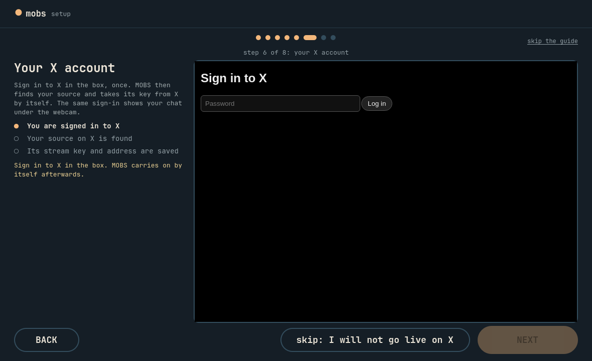
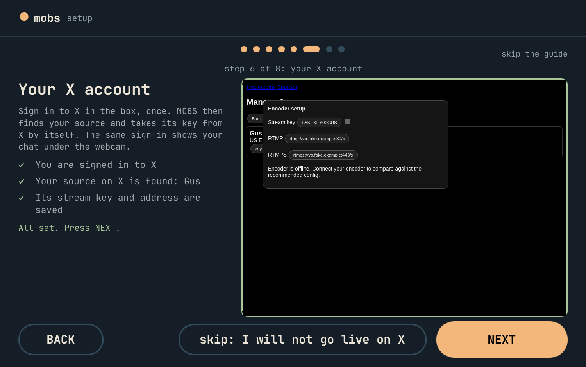
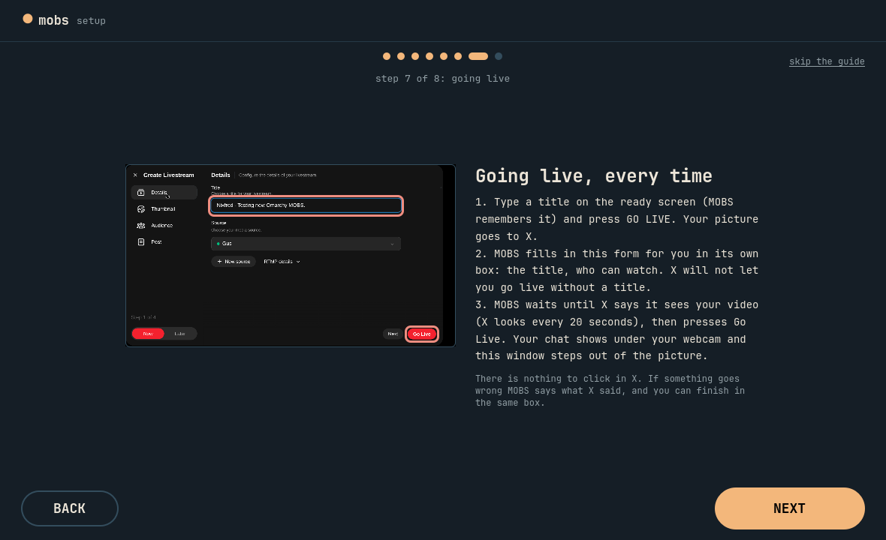
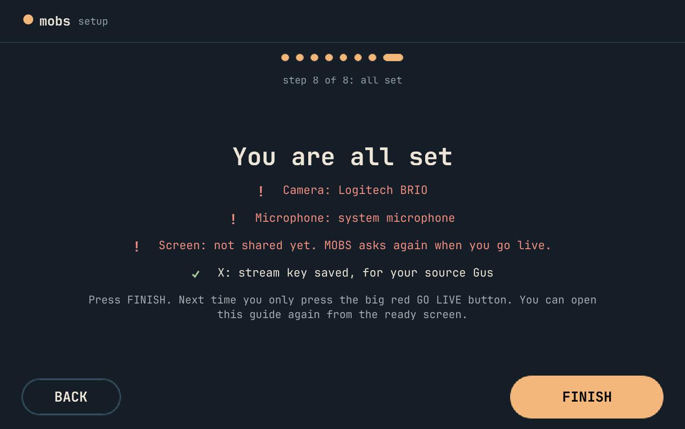
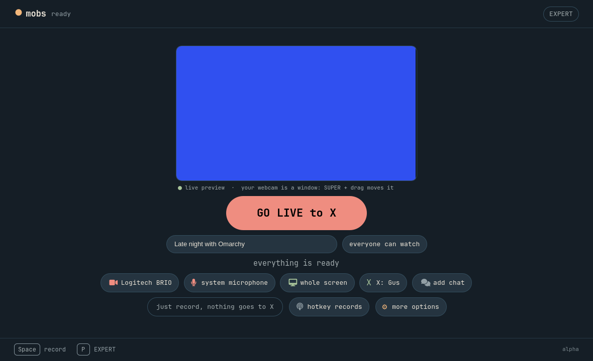
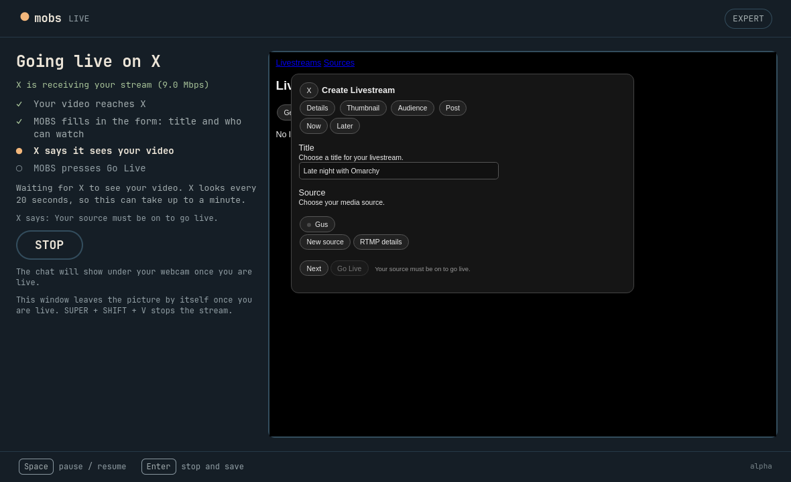
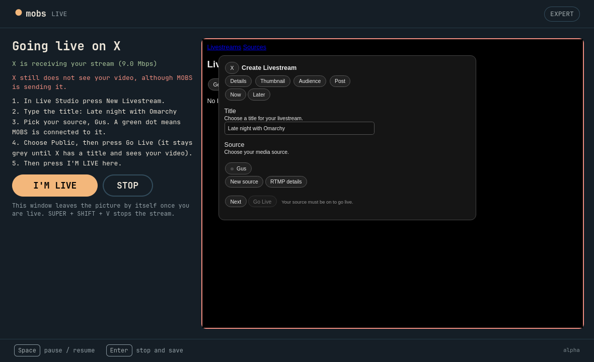

## Screen and me: the simple way

**The first run goes straight to "screen + me"** (or "my screen" when no camera is found): no three cards to puzzle over. The picks live in EXPERT > hardware > *what to share*.

- **It shares a whole screen, never a window or a dragged region.** "My screen" and "screen + me" ask the portal for monitors only (OBS's `pipewire-desktop-capture-source`),
  so you can **change workspaces and the stream follows**. A window or a region was what once made half a picture and a black rest.
  The choice is remembered (`~/.config/mobs/screen-token-desktop`); **the screen chip on the ready screen** opens the guide's screen page, and *choose again* there forgets it and asks again.
- **The webcam is a picture-in-picture WINDOW on your screen, and you move it with SUPER + drag, even while you are live** (Fred, 2026-10-10: "capture the entire screen and put
  the webcam in a pip and allow me to SUPER drag it around during live"). In "screen + me" MOBS captures the **entire screen** and shows your camera in a small window
  (`qml/PipWindow.qml`, a Qt Multimedia camera view). On Hyprland, `PipController` floats it, **pins it to every workspace** (so changing workspaces keeps you in the stream),
  puts it top-right of the usable area, remembers where you leave it, and hands the keyboard straight back to what you were doing. Because it is a real window, Omarchy's own
  **SUPER + left-drag moves it and SUPER + right-drag resizes it**, in any app, mid-broadcast; whatever is on your screen, including the window, is the picture.
  It shows whenever the picture is on (ready screen with the preview on, armed, or a take) and goes when it goes. MOBS finds its OWN window by title **and process id**, so it can
  never grab another window. In this mode libobs opens no camera of its own (one open camera, not two). EXPERT > recording has the toggle "webcam in a window on the screen"; with it off
  the webcam is composited into the picture by libobs instead, and the older **drag handle over the live picture** applies (it moves in the broadcast live, and a corner tap snaps it back).
  Without Hyprland the window is an ordinary window to move yourself. **MOBS steps out of the picture while a take records**: a screen capture shows everything on that screen, MOBS's own window included (a stream of MOBS showing the stream),
  so when a take starts MOBS's window moves silently to a hidden workspace (`special:mobs`) and returns to its own workspace when the take ends (EXPERT toggle "hide MOBS from the picture
  while recording"; only if it is on the monitor that is in the picture: the captured screen's size is matched to the monitor). **SUPER + SHIFT + V stops the take** while it is hidden, and
  desktop notifications say when the stream connects, drops, is not live, and when the take is saved.
- **The webcam window's size and place.** It opens at **20% of the screen's width (480 to 1024 px)**, so it stays visible once the broadcast is scaled to 1080p (a 480 px window on a 5120 px
  ultrawide would be a 180 px dot). Only a place **you chose** (moved with SUPER + drag or resized) is remembered; where MOBS put it is recomputed for whatever screen is there next time.
  A small badge in its corner says **REC**, **LIVE**, **CONNECTING**, **RECONNECTING** or **NOT LIVE**; the viewers see it too, which is how streams usually say LIVE.
- **A webcam window that gets closed during a take comes back.** The window is pinned to every workspace, so it follows you around, but a close (a stray SUPER + Q on it) used to take you
  off the stream for good while the take carried on: nothing in MOBS brought it back until you stopped. Now, **during a take** (starting, recording, paused), MOBS puts it back where you last
  left it, a moment after the close, and a notice says "your webcam window was closed ... MOBS put it back" once it is really there. It stops after **three closes inside a minute** (you mean
  it): the log says "closed again and again during a take: MOBS leaves it closed", a notice says so, and the take is stopped and started again to reset it. **Before a take and after one a
  closed window stays closed**, as it always did, and with the webcam window turned off in EXPERT nothing is reopened. Test: `check_ui.py "webcam window"` (script step `closepip`).

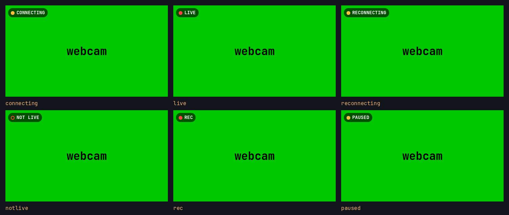
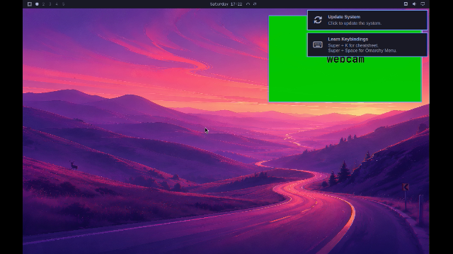
- **GO LIVE to X is the one big red button** on the ready screen (see "Easy mode" above); with no stream key saved it opens the guide at the page that gets one (the key is per machine).
- **A black picture is caught before it reaches X** (Fred, 2026-10-10: the live picture box and a whole take were pure black while MOBS said the stream was fine). The portal can hand
  MOBS a screen share whose frames are all zeros: on gus a dragged **Region** did it, and a stuck portal can too. MOBS now watches the live picture. Once the screen source is up and
  the picture stays black for 6 s it says so in red on the picture and on the ready screen and **refuses GO LIVE** until the picture is real (GO LIVE also waits for one real frame
  after the screen is chosen). If a live picture turns black mid-broadcast, the recording screen says so and a desktop notification fires; MOBS never cuts the stream or the recording
  by itself. Fix: press the screen chip (it turns red and says "screen is black: fix it") and *choose again*; never Region. Still black: `systemctl --user restart xdg-desktop-portal-hyprland xdg-desktop-portal`
  (that ends other apps' screen shares). A camera-only pick is never judged, since a covered lens is the person's choice. The log line is `[capture] the screen picture has been black for ... ms`.

## The dock: your webcam and the chat below you

Fred, 2026-10-10: "put the chat from the live session connected to the bottom of the webcam so I can see myself and the chat going on and move it all at once together. Make the video
resizable and the chat separately resizable but connected as one". The
webcam window (`qml/PipWindow.qml`) is therefore **one window with up to two stacked cards**, so one move carries both:

1. **Your own camera** on top.
2. **The chat card below you**: read-only (you answer with your voice and video, so there is nothing to type into). A glass card with a pulsing "connected" dot; messages slide in at the
   bottom, older ones drift up and fade out at the top; each name gets its own stable colour and an avatar letter. Before the first message, or when the feed is down, it says what is going on.

**Sizes.** The video keeps 16:9 at whatever width the window has, so *resizing the width resizes the video and the chat card's width with it*, and *resizing the height resizes the chat card
alone*. A short window squeezes the video (it crops) before the chat card goes. **A plain drag on your webcam or the chat moves the stack** (SUPER + drag works from anywhere); the bottom edge, the right edge and the
corner resize it, and their grips fade in only while the pointer is over the window (the compositor does the move and resize itself: `xdg_toplevel` move/resize, no `hyprctl` per frame).
The dock with chat remembers its own place (`pipPlaceChat`), separate from the camera alone (`pipPlace`). It is captured with the rest of the screen, so **viewers see the chat card too**.

**The chat in MOBS itself (built 2026-10-12, see "Easy mode" above).** The card under the webcam can show your own livestream's Live Chat, taken from X's page in MOBS's own signed-in browser view.
It needs nothing on another computer. The route below stays as a second way to fill the same card.

**The real chat: from your own browser on another computer (built 2026-10-12, the script on the other computer is NOT built).** Fred's choice (2026-10-12): X gives a program no chat
without an approved API app, so a small script in **your own logged-in browser on another computer** (his Mac, `fnix`) reads the chat the way you read it and POSTs it to MOBS over the tailnet.
MOBS's side is `ChatRelay` (`src/chatrelay.*`). **Off by default**: set `chatRelay=true` in `~/.config/mobs/mobs.conf` (`chatRelayPort`, 8799 by default). It listens on the **tailnet address**
(`tailscale ip -4`) only, falls back to this computer alone when there is no tailscale, and refuses any caller that is not this computer or inside 100.64.0.0/10. There is no login: the tailnet is
the security. The contract: `POST /chat` with `{"messages":[{"id":"stable per line","name":"viewer","text":"words"}]}` answers 204 (an empty list is a heartbeat, a single object works too, an id
seen before is ignored so the script may resend); `GET /health` answers 200. The card says "waiting for the chat script on your other computer" until the first call and "went quiet" 20 seconds
after the last. **What arrives is words from strangers**: control and bidi characters are removed, a line is capped (1000 characters kept, 400 shown), it is shown as **plain text, never as markup**,
and it only ever appears in the card: nothing is sent back to X or to a viewer. Try it from any tailnet computer:
`curl -sS -X POST http://gus.tail0940f.ts.net:8799/chat -d '{"messages":[{"id":"t1","name":"test","text":"hello from fnix"}]}'`. **Not built: the script on the Mac.** It has to read x.com's chat
panel in a logged-in browser, which needs a short session with the person at the Mac and a live broadcast with chat to look at the page. It is automated reading of X's pages, which X's rules
forbid (a small account risk, accepted by Fred), so it stays read-only and runs only in his own browser. Tests: `tst_chatrelay` (parser, cleaning, who may call, a real socket) and
`check_ui.py "chat relay"` (the card fills, the words are plain text).

**Where the chat comes from, otherwise.** `ChatModel` only keeps and shows messages; a feed fills it. There is **no feed by default**, and then there is no chat card. `MOBS_FAKE_CHAT=1 mobs` runs a
made-up flow labelled **DEMO** so the dock can be seen and tried without X. The real feed has to be X's official Livestream API (research, 2026-10-10): chat is **push-only**, an
Activity API `broadcast.chat` event delivered to a public HTTPS webhook (OAuth 2.0 PKCE, scope `broadcast.read`), the API is open only to whitelisted apps, and the docs never say whether a
broadcast started from Live Studio over RTMP is covered. There is no confirmed chat-only pop-out URL, the old Periscope chat socket is reported closed, and X's developer guidelines forbid
scraping, browser automation and iframing X pages. So the plan is a small relay that receives the webhook and that MOBS polls; that waits on X's access.

## The log

MOBS now **always keeps a log**: `~/.local/state/mobs/mobs.log` (`MOBS_LOG_FILE` overrides; EXPERT > about shows the path). It is the first thing to read when something looks wrong.
It keeps what the journal throws away: libobs's informational lines (never its per-frame debug ones), Qt's own warnings, what MOBS found at start (monitors with sizes and
positions, cameras, settings), **the size of every picture it captures** ("screen source is 1920x1080 (whole screen)", "camera source is 1280x720"), every recorder state,
every stream state with its reason, the stream's bitrate and dropped frames every 10 s, picks, the webcam being dragged, hotkey presses, and each take's start line.
**The stream key is never written**: it is registered as a secret the moment a broadcast starts and replaced by `***` in every line, whoever prints it (Qt, libobs, MOBS).
Mode 0600; at 4 MB it rotates to `mobs.log.1` and `.2`.

## Going live to X

MOBS can broadcast a take to X (or any RTMP/RTMPS server) while it records. **The saved file is always the full-quality 1080p copy**, whatever happens
to the broadcast; the stream is a second, constant-bitrate encode of the same picture and sound.

**Set it up once.** The setup guide's X page does it (see "Easy mode" above): the person signs in to X in the box and MOBS **reads the stream key and the server address from X itself**, so nothing is pasted. EXPERT > live is the same
settings without the guide (the address is `rtmp://va.pscp.tv:80/x` until X shows another; `rtmps://va.pscp.tv:443/x` is the encrypted one; X may need Premium and Live Studio is in beta, so check X's page). The quality defaults to **X recommended**, the "recommended" column of X's own encoder panel: **H.264, 1920x1080, 30 fps,
9 Mbps, AAC 128 kbps stereo at 44.1 kHz, a keyframe every 3 seconds**. Lighter choices: light (720p, 3 Mbps) and standard (1080p, 6 Mbps).
**The stream key is a password.** It is kept in its own owner-only file (`~/.config/mobs/stream-key`, mode 0600), never in the settings file, never shown
again after saving, never printed, and scrubbed out of any error text. QML has no way to read it back. Once saved, the page says so and has a **close EXPERT** button.

**To start:** on the ready screen press the big red **GO LIVE to X** button. One click arms the broadcast and starts the take (with no key saved yet it opens the guide at the page that gets one). **Going live is a deliberate step every time**; the other way is the **hotkey** chip, which makes SUPER + SHIFT + V go LIVE instead of just recording. A red line says "GO LIVE broadcasts to X: this screen is public until you stop." Arming is never remembered: it clears when the take ends, when MOBS restarts, and by itself after 15 minutes if no take starts.

**While live** the recording screen shows a LIVE pill (CONNECTING, LIVE, RECONNECTING, or a red outlined NOT LIVE), the bitrate and any dropped frames, and the
header says LIVE. **Pause is off while you broadcast**: viewers would keep watching while the saved file skipped that stretch.

**Am I live on X? Two steps, and MOBS can only do the first.** (1) **LIVE in MOBS means X is receiving your stream**: the recording screen says "X is receiving your stream (9.0 Mbps). Viewers see
it once you press Go live in X Live Studio", the webcam window's badge says LIVE, and a desktop notification says it. (2) **Viewers see nothing until you press "Go live" in X Live Studio**
(studio.x.com/live, your livestream; the recording screen has an "open X Live Studio" link). MOBS cannot see that step.

- **If the stream fails the recording does not.** A refused key or address, or a lost connection after 10 retries (the waits grow from 2 s to about 77 s: roughly four minutes), shows "NOT LIVE: the
  server did not accept the address or stream key. The recording is still being saved." and the take carries on to its file. A dropped connection is retried
  first (RECONNECTING). Once the stream is gone, pause works again.
- **When X keeps hanging up** (Fred, 2026-10-10: "it's connecting and dropping over and over"). X's ingest gives **no error** for a stream key it does not accept: it takes the connection, shows you
  as connected, and hangs up about 3 seconds later; libobs reconnects, forever. Measured against the real X ingest with a deliberately fake key, for both encoders: `connecting > live > reconnecting > live > reconnecting ...`
  every ~5 s, exactly what Fred saw. So after **3 quick drops in a row** (each within 15 s of going live) MOBS **stops retrying** and says "X hung up within seconds, 3 times in a row. The usual cause:
  X no longer accepts this stream key (a key stops working when its livestream ends). In X Live Studio create a New livestream with source RTMP, paste its new key in EXPERT > live, then press GO LIVE".
  One long session in between starts the count over (`StreamHealth`, unit-tested). The same signature will also appear with a mistyped key. `MOBS_X_PROBE=1 ./tst_obsbackend xRefusalLooksLikeThisToMobs`
  (`MOBS_X_PROBE_HARDWARE=1` for NVIDIA) reproduces it against X's ingest with a **fake** key (no account involved) and prints every state with times.
- **Compatibility settings for live ingest**: no B-frames and no look-ahead delay on the NVIDIA encoder (`bframes=0` for x264), and **dynamic bitrate** (on a congested uplink lower the bitrate instead of dropping frames).
- A stream that cannot even start (no encoder) stops the take before it begins, with the reason, instead of a take that quietly never went live.
- The broadcast uses its own registered stream target (`mobs_rtmp` in `obsbackend.cpp`) and not OBS's `rtmp-services` module, because that module asks
  obsproject.com for a service list every time it loads. MOBS never phones home.
- The stream encoder is x264 (veryfast, constant bitrate, keyframe every 3 s) or NVIDIA H.264 when the hardware page says so, plus AAC at 128 kbps: the settings X
  recommends in Live Studio (H.264 + AAC-LC at 44.1 kHz, 9 Mbps, 1080p30, keyframe every 3 s). MOBS now runs its audio engine at 44.1 kHz for that.
- Quitting the window while live stops the take, and with it the broadcast, the same as Stop.

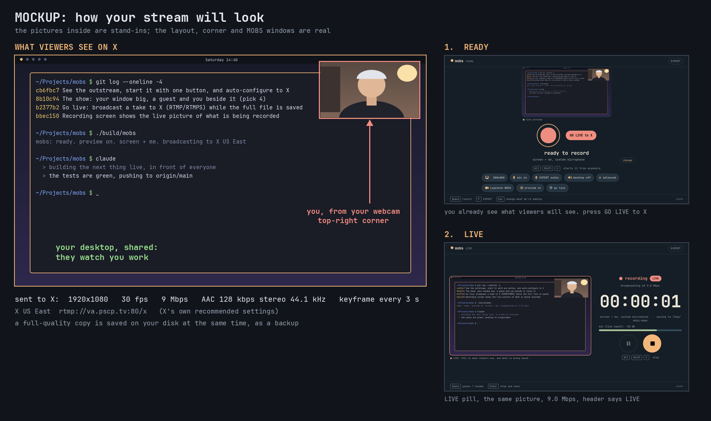


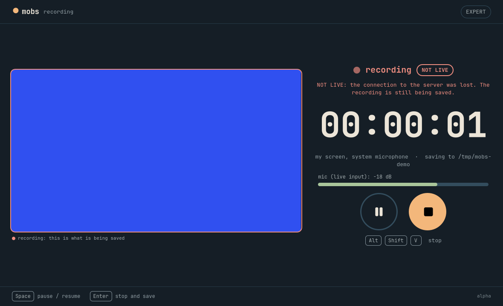
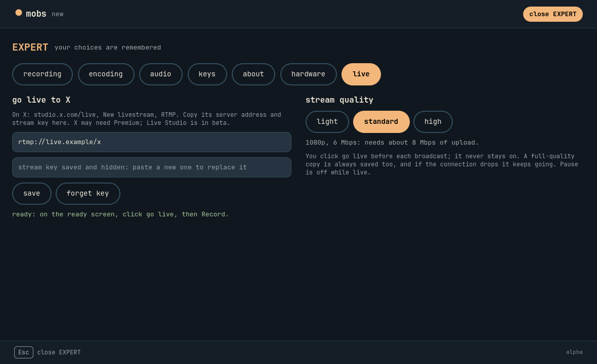

Tested without X: a stand-in server (`ffmpeg -listen 1 -i rtmp://127.0.0.1:PORT/live/KEY`) on this machine. `tst_obsbackend` has three real-libobs scenarios
(a broadcast the server receives and decodes: H.264 + AAC, size, keyframe spacing, tone present, and the full-quality file beside it; a broadcast to a port
nobody listens on, which must say so and leave the file alone; and a take that did not ask for one, which creates nothing) plus a hardware one on a
machine with NVIDIA H.264. The first real broadcast to X is Fred's to start, because it goes to his followers.

## Install: launcher entry, icon, hotkey launch

```sh
cmake --install build --prefix ~/.local     # binary, launcher entry, icon, D-Bus launch file
```

MOBS then shows up in the launcher (SUPER+SPACE, Omalaunch reads `.desktop` files live) as **MOBS** with its icon
(`dist/mobs.svg`: a record ring and dot, viewfinder corners, and a webcam lens in the bottom-right where MOBS puts your
webcam). Right-clicking offers *Start or stop recording* and *Pause or resume*. A test installs into a temporary folder
and checks the paths and that the installed binary starts and draws, because an earlier build only worked next to its
build folder. Re-run the command after rebuilding.

**Getting back to the three choices (my screen / screen + me / just my camera):** click **change** next to the mode text on the
ready screen, press **Esc**, or click the camera chip. They are shown full-screen on first run only.

## The hotkey (physical Alt + Shift + V)

MOBS exports `org.mobs.Control` on the session bus: `Toggle` (start, or stop and save), `Pause` (pause or resume) and
`Status`. A Hyprland bind runs one command from any application:

```sh
busctl --user call org.mobs.Control /org/mobs/Control org.mobs.Control Toggle     # SUPER + SHIFT + V  (physical Alt + Shift + V)
busctl --user call org.mobs.Control /org/mobs/Control org.mobs.Control Pause      # SUPER + CTRL + SHIFT + V
```

If MOBS is not running, D-Bus starts it: copy `dist/org.mobs.Control.service` to `~/.local/share/dbus-1/services/`, replace
`@MOBS_BIN@` with the path of the `mobs` binary, and reload the bus once (or log in again). Proven in the Test Drive VM:
Toggle, Pause, Pause, Toggle made a valid file with the pause cut out; auto-launch started MOBS in 0.5 s.

**One copy at a time.** Whoever owns `org.mobs.Control` is the running MOBS. A second launch asks it for `Status`, writes
"another MOBS is already running" to the log, sends a desktop notice and exits at once: it says whether the first copy is idle or
mid-take ("its window is hidden so it stays out of the picture, SUPER + SHIFT + V stops the take"), and it never opens the
webcam. Why: on 2026-10-12 three copies ran live takes together on one machine, each with its window hidden on the special
workspace, all three holding the same webcam (a webcam serves one program, so the newest got no picture) and all three
streaming with one key (X drops one of them); the hotkey reached only the oldest. A copy that owns the name but does not answer
within 2 s counts as running ("not answering"). Two launches within the same few milliseconds can both pass; the later one then
fails to take the name and warns. `MOBS_NO_HOTKEY=1` turns the guard off (tests that run several copies), and
`MOBS_CONTROL_NAME=org.mobs.SomethingElse` moves a copy to another bus name, so a test never touches the real hotkey door.
`check_ui.py "one copy"` runs it with real copies on a throwaway name: alone it starts, and a second copy is turned away while the
first is idle and while it is recording.

```sh
cmake -S . -B build -G Ninja && cmake --build build
QT_QPA_PLATFORMTHEME=generic QT_QUICK_BACKEND=software QT_QPA_PLATFORM=offscreen ctest --test-dir build --output-on-failure   # unit tests, no window appears
# real libobs recording test (needs a Wayland session, e.g. the Test Drive VM):
QT_QPA_PLATFORM=wayland MOBS_LIBOBS_TEST=1 ./build/tst_obsbackend
./build/mobs
```

Native integration runs each scenario in a separate process, matching the app's single libobs lifetime. The installed OBS NVIDIA plugin cannot reliably unload and reload in one process; repeated takes and NVIDIA/software switching are tested within a single backend. CMake copies and installs the system `obs-nvenc-test` helper alongside MOBS when available, as the NVIDIA plugin expects it there.

Test and screenshot switches (env vars): `MOBS_THEME_DIR` (a fake Omarchy "current" folder), `MOBS_SETTINGS` (settings file),
`MOBS_SCREEN=1` / `MOBS_PICK=1..3` (start screen), `MOBS_WINDOW_SIZE=860x560`, `MOBS_GRAB=/path.png` (save the window's own pixels and quit), `MOBS_TEST_SOURCE=colour` (record a test colour instead of the screen, no picker), `MOBS_REC_DIR`, `MOBS_TOKEN_FILE`, `MOBS_TEST_CAMERA=colour` (a green stand-in webcam), `MOBS_FAKE_CAMERAS=1` (two sample cameras for screenshots), `MOBS_NO_HOTKEY=1`, `MOBS_VERBOSE=1` (libobs logs warnings and errors only otherwise). Script steps also include `pick=N`, `corner=N`, `size=N`, `panel=0/1`, `preview=0/1`, `grabpreview=`, `review=`, `split=`, `cut=`, `savereview`, `waitsaved`, `closereview`, `pro=0/1`, `tab=0..5`, `checklayout`, `key=P/Space/Esc`, `focusfolder`, `foldertext=`, `applyfolder`, `closewindow`, and `expect=state:idle` (also `pro`, `screen`, `confirmQuit`, `folderDefault`). Script `quit` explicitly exits without asking about unsaved test edits.

Script condition `expect=previewing:0|1` reads whether the live picture is running (the fake backend serves a flat colour frame for it).
Script step `click=NAME` also finds items a Repeater made.
Logging: `MOBS_LOG_FILE=/path` (tests use a throwaway one). Webcam window: `expect=pipWanted:0|1`, `expect=pipShown:0|1`; the stand-in picture (no camera opened) is used with `MOBS_TEST_CAMERA` or fake cameras. Dragging (window-off mode): script steps `dragcam=DX:DY` (a real press, move and release on the webcam handle), `movecam=X:Y` (0..1), and `expect=camMoved:0|1`.
Mock-ups: `MOBS_FAKE_PREVIEW=/path.png` (fake backend only) serves that picture in the live preview, so the REAL window can be drawn with a stand-in picture inside it (see `docs/app/mockup-golive-board.png`: stand-in desktop and webcam, real layout, corner and windows).
Going-live switches: `MOBS_STREAM_KEY_FILE` (where the key is kept; scripted runs use a throwaway one). Script steps `arm=0/1`, `streamurl=`, `streamkey=`, `streamquality=N`, and with the fake backend `streamdrop` / `streamretry` / `streamback`; conditions `expect=armed|broadcasting|streamReady:0|1`, `expect=streamState:live` and `expect=streamProblem:text`. EXPERT tab 6 is the live page (`tab=0..6`).
Opening-screen switches: `MOBS_SPLASH=1|0`, `MOBS_SPLASH_AT=MS` (see "The opening screen"); the `expect=splashDone:0|1` script condition reads whether it has finished.
Audio test switches: `MOBS_FAKE_AUDIO=1` lists demo inputs; `MOBS_TEST_AUDIO=file:/path.wav` and `MOBS_TEST_DESKTOP_AUDIO=file:/path.wav` supply generated sound to native tests. `MOBS_FAKE_BACKEND=1` is accepted only with `MOBS_SCRIPT` and exercises QML without capture. EXPERT tabs are `tab=0..5`; scripts also support `openaudio`, `audiodetails=0/1`, `micdevice=`, `desktop=0/1`, `miccheck=0/1`, `micgain=`, and `hardware=0/1`.

Webcam window pointer: script steps `piphover=NAME` and `pipclick=NAME` (a pointer move, or move and click, on the last showing item of that name in the webcam window), `pipprobe=NAME`; conditions `expect=pipHas|pipGone`.
Layout: `src/palette.*` (theme reader), `src/appstate.*` (screens and pick), `qml/` (components and screens), `tests/`.
Screens are checked in the Test Drive practice VM, never on a live desktop; see `docs/app/`.
